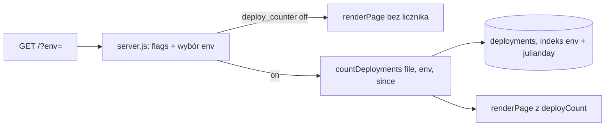

# Architektura zmiany CHG-3

## TL;DR
Licznik wdrożeń liczy serwer: nowa funkcja `countDeployments` w `src/deployments.js` (jedno zapytanie `COUNT`
po istniejącym indeksie), `server.js` woła ją tylko przy włączonej fladze `deploy_counter`, a `renderPage` dostaje
gotową liczbę. Bez nowych zależności, bez zmian schematu, API i CSP. Wariant A zatwierdzony: CHG-3/D2 (DEC-0013).

## Czynniki i ograniczenia
| Czynnik | Źródło |
|---|---|
| Dokładna liczba także przy > 100 wdrożeń; zgodność z zapytaniem wprost do bazy | CHG-3/D2 (DEC-0013), NF-003 |
| Flaga off = strona bajt w bajt jak dziś, baza nietykana | CHG-3/D2, NF-002, E-02E |
| Brak zależności (DL4: Node, `node:sqlite`), CSP `default-src 'self'` bez zmian | intent.md, NF-005 |
| Dosłowna etykieta, nieznane `?env=` → środowisko domyślne | CHG-3/D3 (DEC-0014), FR-003 |
| p95 `GET /` < 200 ms przy 10 000 wdrożeń, flaga on (cel „powinno”, nie blokada) | CHG-3/D3 (DEC-0014), NF-004 |

## Rozwiązanie

Zmiany w istniejących modułach (stan sprawdzony w `src/*.js`):
1. `src/deployments.js` — `COUNT_SQL = SELECT COUNT(*) AS n FROM deployments WHERE env = ? AND julianday(deployed_at) >= julianday(?)`;
   `countDeployments(file, env, since)`: brak pliku → 0, `DatabaseSync(file, { readOnly: true })`, zapytanie
   parametryzowane, `db.close()` w `finally` (wzór: `listDeployments`). `since` to argument (ISO UTC), więc test zamraża czas.
2. `src/server.js` — w gałęzi `GET /`, po `readFlags`: jeśli `isOn(flags, 'deploy_counter', visitor.id)`, to
   `target = ENVIRONMENTS.includes(?env) ? ?env : env`, `since = new Date(Date.now() - 7*24*3600*1000).toISOString()`,
   `deployCount = countDeployments(deploymentsDb, target, since)`. Gdy flaga off, funkcja nie jest wołana (baza nie jest otwierana).
   Błąd odczytu leci do istniejącego `try/catch` → 500 `internal error` (FR-004).
3. `src/page.js` — nowe pole wejściowe `deployCount` (liczba lub `undefined`); `renderPage` nie czyta bazy.
   Licznik `
Wdrożenia w ostatnich 7 dniach: N
` wstawiany **bez zmiany szablonu przy fladze off**:
   zmienna doklejona bezpośrednio za `
` akapitu „Środowisko” (`…</strong>
${counter}`), gdzie `counter` to `''` albo
   `'\n
…
'`. Wstawienie osobnej linii `${counter}` dałoby pustą linię i złamało „bajt w bajt” (NF-002).
   Wartość przechodzi przez `escape` (NF-001).
4. `config/flags.test.json`: `deploy_counter` `{ "enabled": true, "rollout": 100 }`; `config/flags.prod.json`: `{ "enabled": false, "rollout": 0 }`.

Nie zmieniamy: schematu bazy, `scripts/record-deployment.js`, `/deployments`, nagłówka CSP.

## Atrybuty jakości — jak spełnione
| Atrybut | Mechanizm | Weryfikacja |
|---|---|---|
| Dokładność (NF-003) | `COUNT(*)` bez limitu i stronicowania, ta sama kolumna i `julianday` co `LIST_SQL` | E-01B, E-01E, E-02D |
| Brak regresji (NF-002) | licznik doklejony w miejscu, które przy off daje `''`; test porównuje HTML z wynikiem sprzed zmiany | E-02B, E-02E |
| Wydajność (NF-004) | jedno zapytanie po indeksie `deployments_env_time (env, julianday(deployed_at))`; zero zapytań przy off | `EXPLAIN QUERY PLAN` w teście, pomiar p95 przy 10 000 wierszy |
| Bezpieczeństwo (NF-005) | `?env=` tylko z `ENVIRONMENTS`, parametry SQL, `escape`, bez JS klienta | E-03C, E-03D |
| Czas (NF-006) | `since` liczony w serwerze z `Date.now()`, przekazywany jako argument | E-01A, E-01F |

## ADR-1 — Licznik liczony po stronie serwera funkcją `countDeployments` (wariant A)
- **Status:** proposed (wariant zatwierdzony przez człowieka: CHG-3/D2, DEC-0013; ADR zapisuje jego konsekwencje techniczne)
- **Kontekst:** potrzebna dokładna liczba wdrożeń w oknie 7 × 24 h na stronie głównej, bez nowych zależności i bez JS klienta.
- **Rozważone:** A — render na serwerze (wybrany); B — JS w przeglądarce nad `/deployments` (błędna liczba > 100, zmiana CSP i routingu plików);
  C — nowy endpoint `/deployments/count` (większe API bez prośby, YAGNI); D — bez zmian (problem zostaje).
- **Decyzja:** A, z konsekwencjami niżej.
- **Konsekwencje:** strona zależy od odczytu bazy wdrożeń (tylko gdy flaga on); jedno źródło prawdy (tabela `deployments`);
  zapytanie `COUNT` dubluje warunek czasu z `LIST_SQL` (dwa miejsca z `julianday`) — akceptowalne, bo testem E-01E pilnujemy zgodności;
  każde żądanie `GET /` z flagą on otwiera i zamyka bazę (bez cache, zgodnie z FR-002; odwracalne, gdy pomiar p95 przekroczy próg).

## ADR-2 — Licznik doklejony do akapitu „Środowisko”, nie osobna linia szablonu
- **Status:** proposed
- **Kontekst:** NF-002 wymaga identycznego HTML przy fladze off; `banner` i `footer` mają własne linie, więc przy off zostawiają puste linie.
- **Decyzja:** `${counter}` bezpośrednio po `
` akapitu „Środowisko”; przy on zwraca `\n
…
`.
- **Konsekwencje:** szablon wygląda nieco inaczej niż wstawki `banner`/`footer`; komentarz w kodzie wyjaśnia powód. Alternatywa (osobna linia) odrzucona: łamie bajt w bajt.

## ADR-3 — Nieznane `?env=` liczy dla środowiska domyślnego
- **Status:** proposed (treść etykiety i fallback zatwierdzone: CHG-3/D3, DEC-0014)
- **Decyzja:** brak błędu 400 na stronie HTML (inaczej niż `/deployments`); `?env=` spoza `ENVIRONMENTS` jest ignorowane, w HTML nie pojawia się jego wartość (E-03C).
- **Konsekwencje:** zachowanie różni się od `/deployments` (tam 400), co zapisujemy w README przy zmianie funkcji.

## Wydanie i bezpieczeństwo wdrożenia
Jedno cięcie TSK-1 za flagą `deploy_counter` (plan.md, release.yaml). Start: test on, prod off. Włączenie na prod to
etap rolloutu decydowany przez właściciela flagi. Kryterium porażki (b) z CHG-3/D2 (prod `enabled: true` po wdrożeniu)
pilnuje test pliku flag (E-05A). Wycofanie: `enabled: false` w `config/flags.prod.json`, bez rollbacku kodu.

## Weryfikacja wydajności
Test lokalny: 10 000 wierszy w bazie tymczasowej, flaga on, 200 żądań `GET /`, p95 < 200 ms (CHG-3/D3, DEC-0014).
Przekroczenie = sygnał do profilowania, nie blokada.

## Ryzyka
| Ryzyko | Reakcja |
|---|---|
| Rozjazd warunku czasu `COUNT_SQL` vs `LIST_SQL` | test E-01E porównuje z `SELECT COUNT(*)` wprost; zmiana w jednym miejscu wymusza przegląd drugiego |
| Zegar serwera przesunięty | `since` z `Date.now()` w UTC; poza zakresem (jak reszta aplikacji) |
| Flaga prod włączona przez pomyłkę | test E-05A, etap rolloutu z właścicielem |

## Pytania do bramki
- Właściciel aplikacji sdlc-proba: kto jest właścicielem flagi `deploy_counter` (decyduje o przejściu etapów rolloutu) i czy `remove_by: 2027-02-28` w release.yaml (propozycja Tomasza) jest właściwą datą usunięcia flagi?
- Właściciel aplikacji sdlc-proba: jakie kryterium wyjścia z etapu `test` przed włączeniem na prod (propozycja w release.yaml: min. 3 dni na test, zero błędów 5xx w logu serwera i liczba zgodna z `/deployments` w spot-checku)?

## Przekazanie
Następny krok: faza design pokrywa tylko tekst etykiety i miejsce w `<main>` (ustalone: dosłowny tekst, po akapicie „Środowisko”);
potem delivery TSK-1 metodą TDD, testy akceptacyjne E-01A…E-05B pisane najpierw.
