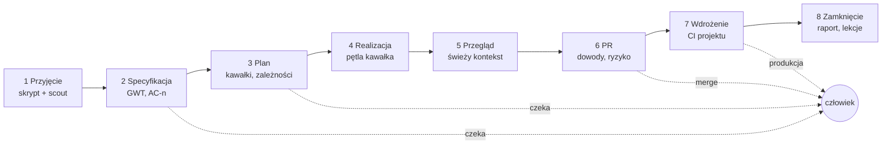

# Oś fabryki: od numeru zadania do wdrożenia (dokument zbiorczy)

Data: 2026-11-12. Status: **propozycja do decyzji człowieka** — nic z tego dokumentu nie jest jeszcze zbudowane, o ile
sekcja 2 nie mówi inaczej. Dokument łączy w jedną całość: plany z `docs/plans/` (zwłaszcza
`2026-11-08-tf-analyze-i-katalog-tf.md` §8–10 i `2026-11-09-luki-katalogu-i-autonomia.md`), tryb Talos z dashboardem
(tf#211), plik `propozycje-wdrozen.md` (tf-1…tf-13, plik użytkownika spoza repo, 2026-11-12), porównanie z dev-kitem
(PDF „AI Playbook”, szkic, 2026-11-12) oraz łańcuch skilli `10x-*` załączony 2026-11-12 (`init`, `shape`, `prd`,
`stack-assess`).

## 1. Cel i podział ról

**Człowiek projektuje, fabryka wykonuje i pilnuje jakości.** Człowiek podaje numer zadania, rozstrzyga to, co jest
decyzją projektową lub biznesową, i zatwierdza wynik. Fabryka robi resztę: specyfikację w formie Given/When/Then,
plan, testy przed kodem, kod, weryfikację, przegląd, PR i dopilnowanie wdrożenia — z zatrzymaniem tylko tam, gdzie
reguła mówi, że potrzebny jest człowiek.

Siedem wymagań, z których wynika reszta dokumentu:

| # | Wymaganie | Sekcja |
|---|---|---|
| W1 | jedno wejście: numer zadania (albo plik, albo tekst) → przebieg do wdrożenia | 3, 9 |
| W2 | zatrzymanie tylko tam, gdzie to konieczne; tryby Plan i Auto jak w Claude Code | 4 |
| W3 | stałe, jedno miejsce na zadanie: kroki, decyzje i dowody w uporządkowanych plikach | 5 |
| W4 | historyjka → scenariusze Given/When/Then → testy (TDD), ze śladem od kryterium do testu | 6 |
| W5 | jakość kodu i projektu pilnowana mechanizmem, a nie prośbą w prompcie | 7 |
| W6 | najtańszy model i effort, który przejdzie weryfikację, dla każdego kroku | 8 |
| W7 | stały podgląd: co się dzieje, na co fabryka czeka, ile to kosztuje | 10 |
| W8 | prostota: fabryka jest zrozumiała dla osoby bez wiedzy o jej budowie (decyzja człowieka 2026-11-12) | 1a |

## 1a. Prostota: co widzi użytkownik

Cała złożoność z dalszych sekcji jest po stronie fabryki. Użytkownik ma znać **jedno polecenie, trzy odpowiedzi
i jeden ekran**:

| Co | Jak |
|---|---|
| jedno polecenie | `/tf PROJ-123` — nic więcej nie trzeba pamiętać; tryby i opcje są dodatkiem, nie warunkiem |
| trzy odpowiedzi | gdy fabryka pyta: **tak**, **popraw: …** albo **zdecyduj sam** |
| jeden ekran | podgląd: co jest robione, co czeka na Ciebie, co gotowe |

Reguły, które obowiązują każdy element osi:
1. **Użytkownik nie wybiera** persony, wagi, modelu ani plików — fabryka dobiera sama i mówi jednym zdaniem, co
   wybrała i dlaczego („Zmiana dotyka logowania, więc pokażę Ci plan przed kodem”).
2. **Prosty język.** Komunikaty do człowieka nie używają słów z budowy fabryki (tier, hook, bramka, kawałek, triaż,
   harness). Zamiast „BRAMKA K2: FAIL” — „Testy drugiego kroku nie przechodzą, poprawiam (próba 2 z 3)”. Słownik
   wewnętrzny zostaje w plikach technicznych i w tym dokumencie.
3. **Pytanie ma zawsze ten sam kształt:** jedno zdanie o co chodzi, 2–3 opcje, rekomendacja i skutek każdej opcji.
   Bez odsyłania do plików, żeby zrozumieć pytanie.
4. **Każdy komunikat kończy się następnym krokiem:** co fabryka zrobi teraz albo czego potrzebuje od Ciebie.
5. **Jedna strona startowa** („Zacznij tutaj”, do 1 ekranu): instalacja, wdrożenie w repo, pierwsze zadanie,
   przegląd wyniku. Reszta przewodnika to materiał dla dociekliwych.
6. **Folder zadania da się przeczytać bez fabryki:** `report.md` zaczyna się od 5 linii zwykłym językiem — co
   zrobiono, co sprawdzono, co zostało do decyzji, ile kosztowało, gdzie jest PR.
7. **Nowa funkcja nie dokłada polecenia**, jeśli da się ją schować za `/tf` albo wykonać automatycznie.

Miara (wchodzi do E0 i powtórki w E8): osoba, która nie zna fabryki, z samą stroną startową doprowadza zadanie do PR;
liczymy polecenia, które musiała wpisać, pytania, których nie zrozumiała, i miejsca, w których utknęła. Cel: ≤3
polecenia do pierwszego PR i zero pytań wymagających znajomości budowy fabryki.

## 2. Stan dziś: części są, osi nie ma

Sprawdzone w repo 2026-11-12 (`main` = e5d5a52).

| Część | Gdzie | Co robi | Czego brakuje do osi |
|---|---|---|---|
| Talos (`mode-talos`) | `talos-story-run` | historyjka → plan (≤5 kawałków) → test, kod, weryfikacja, skan, przegląd zakresu → commit → PR, raport kosztu | wejście to tekst lub `TSK-n`; jedna waga; STOP przerywa całość; artefakty poza gitem |
| Dashboard | `run_state.py`, `.tf/runs/talos/dashboard.html` | etapy (`intake, plan, slices, pr, needs, done`) i rundy bramek | tylko przebiegi Talosa; bez zdarzeń i decyzji |
| pdi (`mode-pdi`) | `pdi-decisions`, `phase_run.py` | zmiana `CHG-n` w `docs/project/changes/`, bramki w skrzynce pdi, fazy przez workflow | osobny, ciężki przepływ; wymaga serwera pdi |
| Dziennik projektu | `docs/project/`, mapa artefaktów (A4) | fazy projektu, decyzje, lekcje, punkt kontrolny `wip` | układ wg faz projektu, nie wg zadania |
| Persony i dyspozytorka | `.claude/agents/`, `maja` | praca w rozmowie, delegacja | brak stałej procedury; użytkownik musi wybrać personę |
| Kształt historyjek | `proc-requirements-shaping`, `requirements_lint.py` | US-NN, AC-n w GWT, lint AC-001…004 i STORY-001 | nie jest krokiem przebiegu; brak śladu AC → test |
| Bramki | `tdd_guard`, `quality_gate`, `guard_bash`, `guard_paths`, `scan_secrets`, `test_lock` | pilnują TDD, końca tury, poleceń, ścieżek, sekretów | `quality_gate` śpi bez `quality-gate.json`; hook po edycji jest tylko szablonem |
| Koszt | `core-cost-control`, `tiers` (fast/std/deep), profile, `cost_report.py` | model i effort na agenta, raport z transkryptów | brak reguły eskalacji w pętli; brak odcisku harnessu w logu |
| Autonomia i ryzyko | `autonomy:` w `config.yaml`, `tf risk` | operacje wymagające zgody, triaż ryzyka zmiany | triaż nie steruje wagą ani trybem przebiegu |
| Analiza i metryki | `tf analyze`, `tf metrics`, `flow_compare.py` | przegląd repo, metryki skuteczności, porównanie przepływów | pomiar przepływów nie był jeszcze uruchomiony |
| Zaplanowane, niezbudowane | plan 2026-11-08 §9, §10 | źródła wiedzy (Jira, Confluence), `work_events.py`, pętla w rdzeniu, `tf work --once` | całość |

Wniosek: każdy element osi istnieje albo ma plan, ale użytkownik sam musi je połączyć. Chaos bierze się z trzech
rzeczy: (1) trzy równoległe przepływy (rozmowa z personą, Talos, pdi) bez reguły wyboru; (2) dwa miejsca na artefakty
zadania (`.tf/runs/talos/…` i `docs/project/changes/CHG-n/`); (3) mechanizmy kontroli wymagające ręcznego włączenia.

## 3. Model docelowy: jeden przebieg

Jedno pojęcie — **przebieg zadania** — i jedno wejście. Talos przestaje być osobnym trybem do wybrania, a staje się
silnikiem etapu realizacji (zgodnie z planem 2026-11-08 §10.3: pętla jako skill rdzenia).

```
/tf PROJ-123            w sesji (albo: /tf story.md, /tf "tekst zadania")
tf work --once          bez nadzoru: jedno gotowe zadanie, koniec w stanie „do przeglądu” (plan §10.6)
```



| Etap | Co powstaje | Kto | Bramka wyjścia (bez modelu) |
|---|---|---|---|
| 1. Przyjęcie | `ticket.md`: treść zgłoszenia, źródło, data; fakty o repo (`plik:linia`); triaż ryzyka | skrypt pobrania, `scout` | zgłoszenie ma kto/co/po co; `tf risk` policzony |
| 2. Specyfikacja | `spec.md`: scenariusze `AC-n` (Given/When/Then), poza zakresem, otwarte pytania | model std | `requirements_lint.py` bez błędów; brak otwartych pytań blokujących |
| 3. Plan | `plan.md`: kawałki pionowe, pokrywane `AC-n`, pliki, zależności, weryfikacja, tier | model std (deep przy wysokim ryzyku) | każde `AC-n` przypisane do kawałka; ≤5 kawałków |
| 4. Realizacja | commit na kawałek; `evidence/K<n>.json` | pętla kawałka | test czerwony → zielony, weryfikacja, skan, zakres; ślad AC → test |
| 5. Przegląd | `review.md`: werdykt i ustalenia | `scope-reviewer`, drugi model przy wysokim ryzyku | brak ustaleń blokujących |
| 6. PR | jeden PR: spec, kawałki, dowody, odłożone, ryzyko, koszt | skrypt + model fast | CI zielone; `plan_drift`, `pr_budget` |
| 7. Wdrożenie | wpis `release` w `task.json`: wersja, środowisko, wynik sprawdzenia | CI projektu; fabryka obserwuje | wydanie i sprawdzenie po wdrożeniu zielone |
| 8. Zamknięcie | `report.md`; lekcje do `lessons.md`; ustalenia → nowe kontrole | skrypt | każde ustalenie ma kontrolę albo decyzję „nie” |

Zasady przebiegu:
- **Plik jest wejściem następnego etapu.** Etap czyta wyłącznie pliki poprzednich etapów i repo, nie historię rozmowy.
  Dzięki temu każdy etap może iść w świeżym kontekście i na innym modelu, a przerwany przebieg wznawia się z plików.
- **Fabryka nie zmyśla.** Brak informacji w zgłoszeniu staje się wpisem w „Otwarte pytania” ze znacznikiem, czy
  blokuje, a nie domysłem w specyfikacji.
- **Etap kończy skrypt, nie deklaracja modelu.** Przejście dalej wymaga zielonej bramki z tabeli.
- **Kawałek zablokowany zamiast STOP** (plan §10.2): pytanie blokuje tylko swój kawałek, a fabryka robi w tym czasie
  kawałki niezależne.

## 4. Tryby i punkty zatrzymania

Dwie niezależne osie. Wagę dobiera fabryka z triażu ryzyka, tryb wybiera człowiek.

**Waga przebiegu** — ile artefaktów i przeglądów (dobór skryptem z `tf risk` i treści zgłoszenia; człowiek może
podnieść, obniżenie wymaga jego potwierdzenia):

| Waga | Kiedy | Różnica |
|---|---|---|
| lekka | zmiana lokalna o jasnym wyniku: tekst, konfiguracja, flaga, błąd z jasną przyczyną | spec i plan w jednym krótkim pliku; jeden kawałek |
| zwykła | kilka zależnych kroków, nowa reguła biznesowa, błąd o nieznanej przyczynie | pełne etapy 1–8 |
| pełna | auth, dane osobowe, płatności, migracja danych, publiczne API, nowy system zewnętrzny | + panel recenzentów specyfikacji (A9), `architect`, `security-reviewer`, drugi przegląd innym modelem |

**Tryb** — kto zatwierdza przejścia (nazwy jak w Claude Code, żeby nie uczyć nowego słownika):

| Tryb | Polecenie | Fabryka czeka na człowieka |
|---|---|---|
| Plan | `/tf KEY --plan` | robi etapy 1–3 bez zmian w kodzie i kończy; realizacja po osobnym poleceniu |
| zwykły (domyślny) | `/tf KEY` | po specyfikacji i planie (jedno zatwierdzenie obu), przed scaleniem PR |
| Auto | `/tf KEY --auto` | tylko w punktach stałych (niżej) |

**Punkty stałe — zatrzymanie w każdym trybie**, bo wynikają z reguły, a nie z preferencji:
1. scalenie PR i wdrożenie na produkcję (polityka autonomii B1: merge należy do człowieka);
2. operacje z `autonomy.operations` (nowa zależność, polecenie na produkcji, destrukcyjny SQL, publikacja…);
3. zmiana kontraktu: publiczne API, schemat danych, migracja, decyzja biznesowa (plan §10.2 pkt 3);
4. otwarte pytanie oznaczone jako blokujące, gdy nie ma już kawałka niezależnego;
5. przekroczony budżet (`--budget`) albo dwie nieudane próby bramki po eskalacji modelu (sekcja 8);
6. waga „pełna”: tryb Auto jest dla niej niedostępny — fabryka przechodzi na zwykły i mówi dlaczego.

Każde zatrzymanie to jedno pytanie z opcjami i rekomendacją (core-plan-interview), zapisane jako zdarzenie
(sekcja 5), widoczne na podglądzie (sekcja 10). Odpowiedź „zdecyduj sam” jest dozwolona tylko dla pytań
nieblokujących i odwracalnych.

## 5. Jedno miejsce na zadanie

Dziś artefakty zadania leżą w dwóch miejscach. Propozycja: **jeden katalog trwały w gicie i jeden roboczy poza
gitem, oba pod kluczem zadania.**

```
docs/project/changes/<KEY>/        trwałe, w gicie, czytane przez ludzi i następne etapy
  task.json        stan przebiegu: etap, tryb, waga, ryzyko, wersje (schemat, harness), PR, wydanie
  ticket.md        1. zgłoszenie (źródło, data pobrania), fakty o repo
  spec.md          2. scenariusze AC-n (Given/When/Then), poza zakresem, otwarte pytania
  plan.md          3. kawałki (pola do odhaczenia = stan wznowienia)
  decisions.md     decyzje człowieka: kto, kiedy, co wybrał (format zgodny z pdi)
  events.jsonl     pytania, niespójności, blokady, konsultacje — zapis tylko skryptem
  review.md        5. werdykt przeglądu
  report.md        8. przebieg, koszt, modele, odłożone do decyzji
  evidence/        dowody bramek: polecenie, kod wyjścia, SHA, czas (małe pliki JSON)
.tf/runs/<KEY>/                    robocze, poza gitem
  transkrypty, SARIF, notatki z prac w tle, logi prób
```

- Klucz to numer z trackera (`PROJ-123`); bez trackera — `T-<data>-<slug>`. Z pdi kluczem zostaje `CHG-n`, a układ
  plików jest ten sam, więc pdi staje się opcjonalną skrzynką bramek nad tym samym katalogiem.
- **Każdy plik etapu ma nagłówek** (frontmatter): `etap`, `status` (szkic | zatwierdzony | nieaktualny), `wejścia`
  (ścieżki i skróty SHA plików, z których powstał), `zatwierdził` (człowiek, data — tylko gdy dotyczy). Zmiana
  `spec.md` po zatwierdzeniu planu oznacza plan jako nieaktualny — wykrywa to skrypt, nie model.
- **Stan czyta i pisze wyłącznie skrypt** (`task_state.py`, następca `run_state.py`): model nie edytuje `task.json`
  ani `events.jsonl` ręcznie. `parked.md` Talosa staje się widokiem zdarzeń, nie osobną listą.
- **Kontrakt ukończenia** (tf-9): kawałek ma stan `planned → implemented → verified | blocked`; `verified` wymaga pliku
  w `evidence/` powstałego po ostatniej edycji plików kawałka. Zdanie „zrobione” bez dowodu nie zmienia stanu.
- Budżet artefaktów (`pr_budget.py`) zostaje: surowe dowody idą do `.tf/runs/`, w gicie zostają skróty.
- Waga lekka: `ticket.md`, `spec.md` i `plan.md` łączą się w jeden `task.md`, żeby drobna zmiana nie niosła pięciu
  plików.

## 6. Od historyjki do testów

1. **Specyfikacja.** Z `ticket.md` powstaje `spec.md`: każda historyjka `US-NN` ma scenariusze `AC-n` w formie
   Zakładając / Gdy / Wtedy, z jedną akcją w kroku Gdy (reguły z `proc-requirements-shaping`). Do tego: lista „poza
   zakresem” i kontrprzykład dla reguły biznesowej (czego system ma nie zrobić). Brak danych → otwarte pytanie.
2. **Lint bez modelu.** `requirements_lint.py`: scenariusz bez Wtedy, słaby wynik, szczegół implementacji, druga
   akcja, kilka akcji w historyjce. Błąd blokuje wyjście z etapu.
3. **Scenariusze testowe.** Każde `AC-n` dostaje w planie co najmniej jeden test z nazwą zawierającą identyfikator
   (`AC-3: …`). Projekt przypadków (klasy równoważności, brzegi) wg `qa-test-design`; przy wadze pełnej testy pisze
   wykonawca, który nie widzi implementacji (`qa-spec-first-testing`, `cleanroom_guard`).
4. **TDD w pętli.** Test czerwony → najmniejszy kod → zielony; `tdd_guard` pilnuje kolejności i ostrzega przy
   osłabieniu testu.
5. **Ślad.** Nowy skrypt `trace_check.py`: każde `AC-n` ma test, każdy test z `AC-n` istnieje w spec, test był
   czerwony przed kodem (z logu `tdd_guard`). Wynik trafia do PR jako tabela AC → test → commit → dowód.
6. **Ochrona wyroczni** (tf-5): w trakcie realizacji `spec.md`, zatwierdzone testy akceptacyjne i konfiguracja bramek
   są chronione przed zapisem (`guard_paths`); zmiana wymaga zdarzenia „zmiana wymagań” i zgody człowieka.

## 7. Jakość pilnowana mechanizmem

Zasada: reguła, której nie pilnuje czujnik, jest sugestią. Każda reguła „nigdy” ma wskazany mechanizm.

| Co | Mechanizm | Stan |
|---|---|---|
| kolejność test → kod | `tdd_guard` (hook) | jest |
| czerwony build nie kończy tury | `quality_gate` (hook Stop) | jest, **ale wymaga konfiguracji** |
| lint i format po edycji pliku | `post_edit_checks.py` | szablon — **do włączenia przy wdrożeniu** |
| bezpieczeństwo zmiany | semgrep OWASP na plikach kawałka, audyt zależności, karencja 7 dni | jest (Talos) |
| zakres zmiany | `scope-reviewer`, `plan_drift`; nowy hook budżetu diffu (tf-2): pliki spoza planu → pytanie | częściowo |
| czytelność i projekt | przegląd wg `eng-clean-code`, `eng-design-principles`; `architect` przy decyzji trudnej do odwrócenia | jest jako skille; do wpięcia w etap 5 |
| niezależny przegląd | świeży kontekst; przy wadze pełnej drugi model (`second_review.py`) | częściowo |
| ustalenie → kontrola (tf-11) | wpis w `factory_feedback.py` wymaga pola „kontrola, która to złapie” | do zrobienia |
| „nigdy” → egzekutor (tf-3) | skrypt sprawdza, że każda reguła „nigdy” z `CLAUDE.md` ma hook, CI albo CODEOWNERS | do zrobienia |
| zasada dwóch z trzech (tf-10) | sesja z niezaufaną treścią (zgłoszenie, strona) nie ma naraz dostępu do danych wrażliwych i zapisu na zewnątrz bez człowieka | reguła + sprawdzenie w hookach, do zrobienia |
| audyt fail-closed (tf-13) | awaria zapisu logu przy operacji wysokiego ryzyka blokuje operację | do sprawdzenia testem |

**Wdrożenie w repo jednym poleceniem** (`tf onboard`, największa luka z porównania z dev-kitem): wykrywa polecenia
testów, lintu, typów i buildu z manifestów i CI, pyta o potwierdzenie, zapisuje `quality-gate.json`, hook po edycji,
`verify.sh` i sekcję poleceń w `CLAUDE.md`, uruchamia bramkę raz i otwiera PR. Od tej chwili kontrole działają
u każdego po `git pull`, a `tf doctor` i start sesji mówią wprost, gdy któraś jest wyłączona.

## 8. Model i effort dla każdego kroku

Fabryka ma już trzy poziomy (`fast` = Haiku/low, `std` = Sonnet/medium, `deep` = Opus/high) i profile kosztu.
Brakuje przypisania do kroków osi i reguły eskalacji. Zasada z `CLAUDE.md` zostaje: modelu ani effortu **sesji** nie
zmienia się w środku zadania (kasuje cache) — dobór odbywa się przez wykonawców (parametr `model` narzędzia Agent).

| Krok | Wykonawca | Poziom |
|---|---|---|
| pobranie zgłoszenia, stan, lint, ślad, skan, raport | skrypt | bez modelu |
| fakty o repo | `scout` | fast |
| wersje i dokumentacja zewnętrzna | `researcher` | fast |
| specyfikacja GWT | autor specyfikacji | std |
| plan | planista | std; deep przy wadze pełnej |
| test i kod kawałka | wykonawca | std; fast dla zmiany mechanicznej ze specyfikacją |
| przegląd zakresu i czytelności | recenzent w świeżym kontekście | std |
| decyzja trudna do odwrócenia, auth, sekrety, IaC | `architect`, `security-reviewer` | deep |
| opis PR, podsumowanie | skrypt + model | fast |

**Eskalacja zamiast zgadywania** (kaskada z `core-cost-control`): bramka czerwona → druga próba na tym samym poziomie
z ustaleniami bramki; znów czerwona → jedna próba poziom wyżej; znów czerwona → kawałek zablokowany i pytanie do
człowieka. Każda eskalacja zapisuje się w `task.json` — z tych danych `tf metrics` policzy, który poziom wystarcza
dla jakiego typu kawałka, i przypisanie w tabeli będzie korygowane pomiarem, a nie opinią.

**Pomiar** (bez niego „najtaniej” jest hasłem):
- koszt na zaakceptowaną zmianę i odsetek przeróbek po przeglądzie (`tf metrics`, B3);
- odcisk harnessu w każdym śladzie (tf-1, tf-12): wersje modelu, promptów, schematów narzędzi, hooków — żeby zmianę
  wyniku dało się przypisać do zmiany harnessu;
- pasmo szumu w ewaluacjach (tf-4): różnica liczy się dopiero powyżej rozrzutu z ≥5 powtórzeń;
- okresowe sprawdzenie nazw modeli w konfiguracji (tf-6).

## 9. Wejście z trackera i wiedza o projekcie

- `/tf PROJ-123` uruchamia **skrypt bez modelu**, który pobiera zgłoszenie (Jira REST, GitHub Issues) do
  `ticket.md` ze źródłem i datą. Model czyta plik, nie tracker. Treść zgłoszenia to dane, nie polecenia
  (core-agent-security). Dostęp tylko do odczytu; token ze zmiennej środowiska. Bez trackera wejściem jest plik albo
  tekst.
- Wiedza o projekcie (Confluence, dokumentacja, decyzje) — plan 2026-11-08 §9: `tf po setup` wykrywa źródła
  i proponuje konfigurację przy pierwszym uruchomieniu; pobranie skryptem do cache; odpowiedzi z cytatem
  i walidatorem; odświeżanie po TTL. Przebieg korzysta z tego w etapach 1–3 zamiast pytać człowieka o to, co jest
  zapisane.
- Zapis do trackera (status, komentarz z linkiem do PR) to osobny, opcjonalny moduł ze zgodą na każdą akcję.

## 10. Stały podgląd

Dashboard z tf#211 zostaje i rośnie razem z osią:
- źródłem jest `task.json` i `events.jsonl` wszystkich zadań, nie tylko przebiegi Talosa;
- kolumny to etapy 1–8; na karcie zadania: tryb, waga, ryzyko, bieżący kawałek i runda bramki, koszt, poziomy modeli;
- osobna, wyróżniona lista **„czeka na Ciebie”**: pytanie, opcje, rekomendacja, od kiedy czeka;
- `tf status [KEY]` daje to samo w terminalu jedną linią na zadanie (do CI, pracy zdalnej i bez przeglądarki);
- powiadomienia (plan §10.2 pkt 4): jedno pytanie na zdarzenie, drobne w podsumowaniu, limit na godzinę.

Podgląd tylko czyta pliki. Nie jest drugą aplikacją ani źródłem prawdy (decyzja 2026-11-10: bez nowych usług).

## 11. Wdrożenie i zamknięcie

Stan uczciwie: dziś fabryka kończy na PR. Wdrożenie należy do CI projektu, a fabryka ma je dopilnować, nie zastąpić.
- Po scaleniu przez człowieka fabryka obserwuje pipeline wydania (wersja wg `core-semver`, strategia wg
  `ops-release-engineering`: flaga, canary, wycofanie) i zapisuje wynik w `task.json`.
- Sprawdzenie po wdrożeniu: test dymny albo sonda zdrowia zdefiniowana w `verify.sh`/konfiguracji projektu; wynik
  czerwony → zdarzenie „wycofać?” z rekomendacją.
- Produkcja zawsze za zgodą człowieka (`prod_command: confirm`). Automatyczne scalanie zmian niskiego ryzyka — dopiero
  po danych z `tf metrics` i osobnej decyzji.
- Zamknięcie: `report.md`, status zadania `done`, lekcje do `lessons.md`, a każde ustalenie z przeglądu dostaje
  kontrolę (sekcja 7). Folder zadania zostaje w `changes/` jako ślad; archiwizacja — do decyzji (D5).

## 12. Porównanie z innymi rozwiązaniami

Kolumny z tabeli w PDF „AI Playbook” (s. 8–9) plus trzy, których tam nie ma. Wiersze obcych narzędzi pochodzą z tego
PDF, ze specyfikacji Symphony (plan §10.6) i z załączonych skilli `10x-*`; poza tym **nie były sprawdzane w kodzie
[niezweryfikowane]**. Wiersz „tf dziś” — z sekcji 2. Wiersz „tf docelowo” to cel tego dokumentu, nie stan.

| Rozwiązanie | Spec przed kodem | Zatwierdzany plan | Kontrole maszynowe | Co pilnuje zasad | Stan między sesjami | Waga wg ryzyka | Dobór modelu z pomiarem | Dowód ukończenia |
|---|---|---|---|---|---|---|---|---|
| Spec Kit, OpenSpec, BMAD | ✓ | ✓ | częściowo | markdown | częściowo | – | – | – |
| Superpowers, GSD | ✓ | ✓ | ✓ | częściowo | ✓ | – | częściowo | – |
| dev-kit (PDF) | ✓ | ✓ | ✓ | hook | ✓ | ręczny wybór z 4 przebiegów | ✓ (bez opisu pomiaru) | – |
| łańcuch `10x-*` | ✓ (shape → PRD) | ✓ | lint w skillu | markdown | ✓ (checkpoint w pliku) | – | – | – |
| Symphony (SPEC) | – | – | zależne od repo | usługa | ✓ (tracker) | – | – | stan „do przeglądu” |
| **tf dziś** | ✓ (Talos, pdi) | ✓ | częściowo (bramka śpi) | hook po konfiguracji | ✓ | – | poziomy, bez pomiaru w pętli | – |
| **tf docelowo** | ✓ z lintem i śladem AC → test | ✓ | ✓ od wdrożenia | hook + skrypt bramki etapu | ✓ pliki zadania | ✓ automatycznie z triażu | ✓ eskalacja + metryki | ✓ `evidence/` |

Czym fabryka ma być lepsza, a nie tylko równa:
1. **Zatrzymania z reguły, nie z nawyku.** Inni każą wybrać przebieg albo zatrzymują się po każdym kroku. Tu punkty
   stałe wynikają z ryzyka i odwracalności, a pytanie blokuje jeden kawałek, nie całą pracę.
2. **Etap kończy skrypt.** W łańcuchach opartych na plikach (dobry wzorzec: plik jako wejście następnego kroku)
   zgodność ze schematem sprawdza zwykle sam model. Tu robi to walidator bez modelu, a nieaktualność wykrywają skróty
   SHA wejść.
3. **Dowód zamiast deklaracji.** Stan „zweryfikowane” istnieje tylko z artefaktem dowodu nowszym niż ostatnia edycja.
4. **Ślad od kryterium do testu** i ochrona specyfikacji przed zmianą w trakcie realizacji.
5. **Ekonomia mierzona.** Poziom modelu na krok, eskalacja po porażce i korekta przypisania z metryk, z pasmem szumu.
6. **Bez nowej usługi.** Pliki, skrypty, hooki i CLI; podgląd to widok na pliki.

Czego się uczymy od innych (wzorzec, nie kopia): wdrożenie jednym poleceniem i strona startowa (dev-kit); plik jako
wejście etapu, wykrywanie nowy/istniejący projekt i zasada „nie zmyślaj, zapisz pytanie” (`10x-*`); stany zajęcia
zadania i `git worktree` na zadanie (Symphony).

## 13. Co łączymy, co zostaje, co wygaszamy

| Element | Rola w osi | Działanie |
|---|---|---|
| Talos | silnik etapu 4 (pętla kawałka) | pętla przechodzi do rdzenia; `/talos-story-run` zostaje jako alias `/tf` do czasu pomiaru `flow_compare` |
| `run_state.py`, dashboard | podgląd osi | uogólnienie na `task.json` i zdarzenia |
| `.tf/runs/talos/<data>-<slug>/` | katalog roboczy | przechodzi w `.tf/runs/<KEY>/`; trwałe pliki do `docs/project/changes/<KEY>/` |
| pdi | opcjonalna skrzynka bramek i rejestr decyzji | ten sam katalog zadania; bez zmian w kontrakcie pdi |
| persony | specjaliści wołani przez oś; praca koncepcyjna poza zadaniem | bez zmian; wykonawcy person znikają z listy widocznej dla użytkownika |
| `maja` (dyspozytorka) | wybór wagi i specjalistów w etapie 1 | reguły wyboru przechodzą do skryptu triażu; maja zostaje dla problemów bez zadania |
| `core-delivery-lifecycle`, mapa artefaktów | mapa faz projektu (większa skala niż zadanie) | dopisać sekcję „zadanie” wskazującą katalog z sekcji 5 |
| `project_record wip` | punkt kontrolny pracy poza osią | bez zmian; w osi zastępuje go `task.json` |
| `proc-requirements-shaping`, `qa-*` | treść etapów 2 i 4 | wpięcie jako kroki; bez zmiany treści skilli |
| propozycje tf-1…tf-13 | sekcje 5–8 | tf-8 bez działania; tf-7 (mapowanie OWASP ASI) opcjonalnie po E5 |
| plan 2026-11-08 §9 i §10, plan 2026-11-09 B | szczegóły etapów | pozostają źródłem szczegółów; ten dokument ustala kolejność |

## 14. Kolejność budowy

Każdy etap to osobny plan w `docs/plans/`, TDD i osobny PR. Etap ma sprawdzalne kryterium końca.

| Etap | Zakres | Kryterium końca |
|---|---|---|
| E0 | pomiar bazowy na repo testowym: liczba decyzji i poleceń od instalacji do zielonego PR, czas, koszt; test laika (sekcja 1a); strona „Zacznij tutaj” | raport w `docs/evals/` |
| E1 | `tf onboard`: bramki włączone przy wdrożeniu; komunikat w `tf doctor` i na starcie sesji | w czystym repo bramka blokuje czerwony test bez ręcznej konfiguracji |
| E2 | katalog zadania i `task_state.py` (stan, nagłówki, dowody, nieaktualność); Talos pisze do nowego układu | testy Talosa zielone; przerwany przebieg wznawia się z plików |
| E3 | etap specyfikacji: `spec.md` z GWT, lint jako bramka, `trace_check.py`, ochrona wyroczni | PR zawiera tabelę AC → test → commit → dowód |
| E4 | jedno wejście `/tf`, waga z triażu, tryby Plan / zwykły / Auto, punkty stałe | scenariusze flow-evals: lekka, zwykła i pełna zatrzymują się tam, gdzie mówi sekcja 4 |
| E5 | `events.jsonl` (`work_events.py`), kawałek zablokowany zamiast STOP, eskalacja modelu, podgląd „czeka na Ciebie” | pytanie blokujące nie zatrzymuje kawałka niezależnego |
| E6 | wejście z trackera skryptem; `tf po setup` z podpowiedzią przy pierwszym uruchomieniu | `/tf KEY` działa na fixture zgłoszenia bez sieci |
| E7 | wdrożenie i zamknięcie: obserwacja wydania, sprawdzenie po wdrożeniu, ustalenie → kontrola | wynik wydania w `task.json`; ustalenie bez kontroli czerwieni bramkę zamknięcia |
| E8 | `tf work --once` (bez nadzoru, worktree na zadanie), odcisk harnessu, pasmo szumu | pilotaż na zadaniach niskiego ryzyka; powtórka pomiaru E0 |

Warunki: płatne ewaluacje i `flow_compare` tylko za zgodą człowieka (dziś wstrzymane — limit tygodniowy); wygaszenie
Talosa jako osobnej persony dopiero po danych z pomiaru; E1 i E2 nie zależą od żadnej decyzji z sekcji 15 poza D1.

## 15. Decyzje dla człowieka

| # | Decyzja | Rekomendacja |
|---|---|---|
| D1 | trwałe pliki zadania w gicie (`docs/project/changes/<KEY>/`) czy poza gitem jak dziś w Talosie | w gicie, z budżetem artefaktów; surowe dane poza gitem |
| D2 | nazwa wejścia: `/tf` (nowy skill) czy rozbudowa `/talos-story-run` | `/tf`, a stara nazwa jako alias |
| D3 | trzy wagi dobierane automatycznie czy ręczny wybór przebiegu | automatycznie, człowiek może podnieść |
| D4 | pierwszy tracker: Jira czy GitHub Issues | ten, którego używa pierwszy projekt pilotażowy |
| D5 | co z folderem zadania po zamknięciu: zostaje czy archiwum | zostaje; archiwizacja po 90 dniach skryptem |
| D6 | czy tryb Auto może scalać zmiany niskiego ryzyka | nie teraz; wrócić po danych z `tf metrics` |
| D7 | kolejność: E1 (kontrole) przed E2–E4 (oś) czy odwrotnie | E1 najpierw — najtańsze i daje największy zysk jakości |
| D8 | domyślna instalacja: zestaw minimalny (rdzeń, `pack-it`, Talos) czy jak dziś | minimalny, po pomiarze kosztu kontekstu listy agentów |

## Źródła
- Repo fabryki, stan `main` e5d5a52 (2026-11-12): pliki wymienione w sekcji 2.
- `docs/plans/2026-11-08-tf-analyze-i-katalog-tf.md` §8–10; `docs/plans/2026-11-09-luki-katalogu-i-autonomia.md` B1–B4.
- `propozycje-wdrozen.md` (2026-11-12, plik użytkownika; źródła wtórne — autor sam oznacza je jako hipotezy).
- PDF „AI Playbook” (szkic do przeglądu, 18 stron, przeczytany 2026-11-12) — opis dev-kitu i tabela podejść.
- Skille `10x-init`, `10x-shape`, `10x-prd`, `10x-stack-assess` (załączone 2026-11-12, przeczytane w całości).
- Tryby uprawnień Claude Code: code.claude.com/docs/en/permission-modes (odczyt 2026-11-05, wg `GUIDE.md` Talosa).
