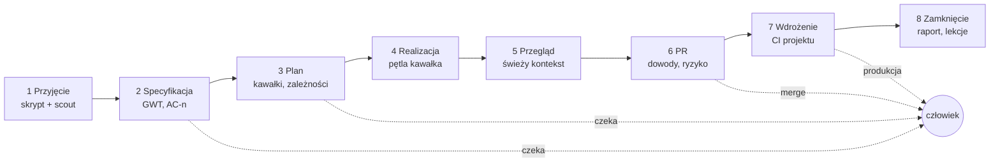

# Oś fabryki: od numeru zadania do wdrożenia (dokument zbiorczy)

Data: 2026-11-12. Status: **propozycja do decyzji człowieka** — nic z tego dokumentu nie jest jeszcze zbudowane, o ile
sekcja 2 nie mówi inaczej. Dokument łączy w jedną całość: plany z `docs/plans/` (zwłaszcza
`2026-11-08-tf-analyze-i-katalog-tf.md` §8–10 i `2026-11-09-luki-katalogu-i-autonomia.md`), tryb Talos z dashboardem
(tf#211), plik `propozycje-wdrozen.md` (tf-1…tf-13, plik użytkownika spoza repo, 2026-11-12), porównanie z dev-kitem
(PDF „AI Playbook”, szkic, 2026-11-12), łańcuch skilli `10x-*` załączony 2026-11-12 (`init`, `shape`, `prd`,
`stack-assess`) oraz 14 artykułów zespołów Anthropic z claude.dev wskazanych przez człowieka (S1–S14, sekcja 16).

## 1. Cel i podział ról

**Człowiek projektuje, fabryka wykonuje i pilnuje jakości.** Człowiek podaje numer zadania, rozstrzyga to, co jest
decyzją projektową lub biznesową, i zatwierdza wynik. Fabryka robi resztę: specyfikację w formie Given/When/Then,
plan, testy przed kodem, kod, weryfikację, przegląd, PR i dopilnowanie wdrożenia — z zatrzymaniem tylko tam, gdzie
reguła mówi, że potrzebny jest człowiek.

Siedem wymagań, z których wynika reszta dokumentu:

| # | Wymaganie | Sekcja |
|---|---|---|
| W1 | jedno wejście: numer zadania (albo plik, albo tekst) → przebieg do wdrożenia | 3, 9 |
| W2 | zatrzymanie tylko tam, gdzie to konieczne; tryby Plan i Auto jak w Claude Code | 4 |
| W3 | stałe, jedno miejsce na zadanie: kroki, decyzje i dowody w uporządkowanych plikach | 5 |
| W4 | historyjka → scenariusze Given/When/Then → testy (TDD), ze śladem od kryterium do testu | 6 |
| W5 | jakość kodu i projektu pilnowana mechanizmem, a nie prośbą w prompcie | 7 |
| W6 | najtańszy model i effort, który przejdzie weryfikację, dla każdego kroku | 8 |
| W7 | stały podgląd: co się dzieje, na co fabryka czeka, ile to kosztuje | 10 |
| W8 | prostota: fabryka jest zrozumiała dla osoby bez wiedzy o jej budowie (decyzja człowieka 2026-11-12) | 1a |

## 1a. Prostota: co widzi użytkownik

Cała złożoność z dalszych sekcji jest po stronie fabryki. Użytkownik ma znać **jedno polecenie, trzy odpowiedzi
i jeden ekran**:

| Co | Jak |
|---|---|
| jedno polecenie | `/tf PROJ-123` — nic więcej nie trzeba pamiętać; tryby i opcje są dodatkiem, nie warunkiem |
| trzy odpowiedzi | gdy fabryka pyta: **tak**, **popraw: …** albo **zdecyduj sam** |
| jeden ekran | podgląd: co jest robione, co czeka na Ciebie, co gotowe |

Reguły, które obowiązują każdy element osi:
1. **Użytkownik nie wybiera** persony, wagi, modelu ani plików — fabryka dobiera sama i mówi jednym zdaniem, co
   wybrała i dlaczego („Zmiana dotyka logowania, więc pokażę Ci plan przed kodem”).
2. **Prosty język.** Komunikaty do człowieka nie używają słów z budowy fabryki (tier, hook, bramka, kawałek, triaż,
   harness). Zamiast „BRAMKA K2: FAIL” — „Testy drugiego kroku nie przechodzą, poprawiam (próba 2 z 3)”. Słownik
   wewnętrzny zostaje w plikach technicznych i w tym dokumencie.
3. **Pytanie ma zawsze ten sam kształt:** jedno zdanie o co chodzi, 2–3 opcje, rekomendacja i skutek każdej opcji.
   Bez odsyłania do plików, żeby zrozumieć pytanie. Pytanie zadaje narzędzie pytań z opcjami do wyboru
   (AskUserQuestion), a nie umówiony format tekstu — format w tekście model gubi (S4).
4. **Każdy komunikat kończy się następnym krokiem:** co fabryka zrobi teraz albo czego potrzebuje od Ciebie.
5. **Jedna strona startowa** („Zacznij tutaj”, do 1 ekranu): instalacja, wdrożenie w repo, pierwsze zadanie,
   przegląd wyniku. Reszta przewodnika to materiał dla dociekliwych.
6. **Folder zadania da się przeczytać bez fabryki:** `report.md` i każde podsumowanie zaczynają się od trzech
   nagłówków w stałej kolejności: **Czeka na Ciebie**, **Zmienione**, **Znalezione** (S10) — potem koszt i link do PR.
   To, czego fabryka nie zdołała potwierdzić, jest wymienione wprost, z informacją, gdzie szukała.
7. **Nowa funkcja nie dokłada polecenia**, jeśli da się ją schować za `/tf` albo wykonać automatycznie.
8. **Zrozumienie kodu na żądanie:** zamiast czytać diffy linia po linii, człowiek prosi o wyjaśnienie wskazanej części
   systemu (tekst albo strona z diagramem), zgodne z kodem z dziś (S12). Uwaga człowieka idzie na decyzje i dowody.

Miara (wchodzi do E0 i powtórki w E8): osoba, która nie zna fabryki, z samą stroną startową doprowadza zadanie do PR;
liczymy polecenia, które musiała wpisać, pytania, których nie zrozumiała, i miejsca, w których utknęła. Cel: ≤3
polecenia do pierwszego PR i zero pytań wymagających znajomości budowy fabryki.

## 2. Stan dziś: części są, osi nie ma

Sprawdzone w repo 2026-11-12 (`main` = e5d5a52).

| Część | Gdzie | Co robi | Czego brakuje do osi |
|---|---|---|---|
| Talos (`mode-talos`) | `talos-story-run` | historyjka → plan (≤5 kawałków) → test, kod, weryfikacja, skan, przegląd zakresu → commit → PR, raport kosztu | wejście to tekst lub `TSK-n`; jedna waga; STOP przerywa całość; artefakty poza gitem |
| Dashboard | `run_state.py`, `.tf/runs/talos/dashboard.html` | etapy (`intake, plan, slices, pr, needs, done`) i rundy bramek | tylko przebiegi Talosa; bez zdarzeń i decyzji |
| pdi (`mode-pdi`) | `pdi-decisions`, `phase_run.py` | zmiana `CHG-n` w `docs/project/changes/`, bramki w skrzynce pdi, fazy przez workflow | osobny, ciężki przepływ; wymaga serwera pdi |
| Dziennik projektu | `docs/project/`, mapa artefaktów (A4) | fazy projektu, decyzje, lekcje, punkt kontrolny `wip` | układ wg faz projektu, nie wg zadania |
| Persony i dyspozytorka | `.claude/agents/`, `maja` | praca w rozmowie, delegacja | brak stałej procedury; użytkownik musi wybrać personę |
| Kształt historyjek | `proc-requirements-shaping`, `requirements_lint.py` | US-NN, AC-n w GWT, lint AC-001…004 i STORY-001 | nie jest krokiem przebiegu; brak śladu AC → test |
| Bramki | `tdd_guard`, `quality_gate`, `guard_bash`, `guard_paths`, `scan_secrets`, `test_lock` | pilnują TDD, końca tury, poleceń, ścieżek, sekretów | `quality_gate` śpi bez `quality-gate.json`; hook po edycji jest tylko szablonem |
| Koszt | `core-cost-control`, `tiers` (fast/std/deep), profile, `cost_report.py` | model i effort na agenta, raport z transkryptów | brak reguły eskalacji w pętli; brak odcisku harnessu w logu |
| Autonomia i ryzyko | `autonomy:` w `config.yaml`, `tf risk` | operacje wymagające zgody, triaż ryzyka zmiany | triaż nie steruje wagą ani trybem przebiegu |
| Analiza i metryki | `tf analyze`, `tf metrics`, `flow_compare.py` | przegląd repo, metryki skuteczności, porównanie przepływów | pomiar przepływów nie był jeszcze uruchomiony |
| Zaplanowane, niezbudowane | plan 2026-11-08 §9, §10 | źródła wiedzy (Jira, Confluence), `work_events.py`, pętla w rdzeniu, `tf work --once` | całość |

Wniosek: każdy element osi istnieje albo ma plan, ale użytkownik sam musi je połączyć. Chaos bierze się z trzech
rzeczy: (1) trzy równoległe przepływy (rozmowa z personą, Talos, pdi) bez reguły wyboru; (2) dwa miejsca na artefakty
zadania (`.tf/runs/talos/…` i `docs/project/changes/CHG-n/`); (3) mechanizmy kontroli wymagające ręcznego włączenia.

## 3. Model docelowy: jeden przebieg

Jedno pojęcie — **przebieg zadania** — i jedno wejście. Talos przestaje być osobnym trybem do wybrania, a staje się
silnikiem etapu realizacji (zgodnie z planem 2026-11-08 §10.3: pętla jako skill rdzenia).

```
/tf PROJ-123            w sesji (albo: /tf story.md, /tf "tekst zadania")
tf work --once          bez nadzoru: jedno gotowe zadanie, koniec w stanie „do przeglądu” (plan §10.6)
```



| Etap | Co powstaje | Kto | Bramka wyjścia (bez modelu) |
|---|---|---|---|
| 1. Przyjęcie | `ticket.md`: treść zgłoszenia, źródło, data; fakty o repo (`plik:linia`); triaż ryzyka | skrypt pobrania, `scout` | zgłoszenie ma kto/co/po co; `tf risk` policzony |
| 2. Specyfikacja | `spec.md`: scenariusze `AC-n` (Given/When/Then), poza zakresem, otwarte pytania | model std | `requirements_lint.py` bez błędów; brak otwartych pytań blokujących |
| 3. Plan | `plan.md`: kawałki pionowe, pokrywane `AC-n`, pliki, zależności, weryfikacja, tier | model std (deep przy wysokim ryzyku) | każde `AC-n` przypisane do kawałka; ≤5 kawałków |
| 4. Realizacja | commit na kawałek; `evidence/K<n>.json` | pętla kawałka | test czerwony → zielony, weryfikacja, skan, zakres; ślad AC → test |
| 5. Przegląd | `review.md`: werdykt i ustalenia | `scope-reviewer`, drugi model przy wysokim ryzyku | brak ustaleń blokujących |
| 6. PR | jeden PR: spec, kawałki, dowody, odłożone, ryzyko, koszt | skrypt + model fast | CI zielone; `plan_drift`, `pr_budget` |
| 7. Wdrożenie | wpis `release` w `task.json`: wersja, środowisko, wynik sprawdzenia | CI projektu; fabryka obserwuje | wydanie i sprawdzenie po wdrożeniu zielone |
| 8. Zamknięcie | `report.md`; lekcje do `lessons.md`; ustalenia → nowe kontrole | skrypt | każde ustalenie ma kontrolę albo decyzję „nie” |

Zasady przebiegu:
- **Plik jest wejściem następnego etapu.** Etap czyta wyłącznie pliki poprzednich etapów i repo, nie historię rozmowy.
  Dzięki temu każdy etap może iść w świeżym kontekście i na innym modelu, a przerwany przebieg wznawia się z plików.
- **Fabryka nie zmyśla.** Brak informacji w zgłoszeniu staje się wpisem w „Otwarte pytania” ze znacznikiem, czy
  blokuje, a nie domysłem w specyfikacji.
- **Etap kończy skrypt, nie deklaracja modelu.** Przejście dalej wymaga zielonej bramki z tabeli.
- **Kawałek zablokowany zamiast STOP** (plan §10.2): pytanie blokuje tylko swój kawałek, a fabryka robi w tym czasie
  kawałki niezależne.

## 4. Tryby i punkty zatrzymania

Dwie niezależne osie. Wagę dobiera fabryka z triażu ryzyka, tryb wybiera człowiek.

**Waga przebiegu** — ile artefaktów i przeglądów (dobór skryptem z `tf risk` i treści zgłoszenia; człowiek może
podnieść, obniżenie wymaga jego potwierdzenia):

| Waga | Kiedy | Różnica |
|---|---|---|
| lekka | zmiana lokalna o jasnym wyniku: tekst, konfiguracja, flaga, błąd z jasną przyczyną | spec i plan w jednym krótkim pliku; jeden kawałek |
| zwykła | kilka zależnych kroków, nowa reguła biznesowa, błąd o nieznanej przyczynie | pełne etapy 1–8 |
| pełna | auth, dane osobowe, płatności, migracja danych, publiczne API, nowy system zewnętrzny | + panel recenzentów specyfikacji (A9), `architect`, `security-reviewer`, drugi przegląd innym modelem |

**Tryb** — kto zatwierdza przejścia (nazwy jak w Claude Code, żeby nie uczyć nowego słownika):

| Tryb | Polecenie | Fabryka czeka na człowieka |
|---|---|---|
| Plan | `/tf KEY --plan` | robi etapy 1–3 bez zmian w kodzie i kończy; realizacja po osobnym poleceniu |
| zwykły (domyślny) | `/tf KEY` | po specyfikacji i planie (jedno zatwierdzenie obu), przed scaleniem PR |
| Auto | `/tf KEY --auto` | tylko w punktach stałych (niżej) |

**Punkty stałe — zatrzymanie w każdym trybie**, bo wynikają z reguły, a nie z preferencji:
1. scalenie PR i wdrożenie na produkcję (polityka autonomii B1: merge należy do człowieka);
2. operacje z `autonomy.operations` (nowa zależność, polecenie na produkcji, destrukcyjny SQL, publikacja…);
3. zmiana kontraktu: publiczne API, schemat danych, migracja, decyzja biznesowa (plan §10.2 pkt 3);
4. otwarte pytanie oznaczone jako blokujące, gdy nie ma już kawałka niezależnego;
5. przekroczony budżet (`--budget`) albo dwie nieudane próby bramki po eskalacji modelu (sekcja 8);
6. waga „pełna”: tryb Auto jest dla niej niedostępny — fabryka przechodzi na zwykły i mówi dlaczego.

**Ryzyko wyznacza zmiana, nie autor** (praktyka zespołu Claude Code, S12; u nas jako reguły triażu):
- ścieżki, które zawsze wymagają człowieka, niezależnie od wagi: pliki workflow CI, auth, rozliczenia, instalator
  i aktualizator, wszystko, co właściciel oznaczył jako wrażliwe (CODEOWNERS, ochrona gałęzi);
- akceptacja agenta nigdy nie zastępuje akceptacji człowieka; zgoda człowieka dotyczy konkretnego commita i wygasa,
  gdy dojdą commity, których fabryka nie może poświadczyć;
- osoba, która zleciła zmianę, odpowiada za nią tak, jakby sama napisała kod.

**Agent nie rezygnuje na podstawie własnej oceny trudności.** W eksperymencie S1 wykonawcy uznali 47 z 60 zadań
za niewykonalne w budżecie, a zespół udowodnił większość z nich. „To niewykonalne” nie jest powodem zatrzymania —
powodem jest dowód (polecenie i wynik) po wyczerpaniu eskalacji z sekcji 8.

Każde zatrzymanie to jedno pytanie z opcjami i rekomendacją (core-plan-interview), zapisane jako zdarzenie
(sekcja 5), widoczne na podglądzie (sekcja 10). Odpowiedź „zdecyduj sam” jest dozwolona tylko dla pytań
nieblokujących i odwracalnych.

## 5. Jedno miejsce na zadanie

Dziś artefakty zadania leżą w dwóch miejscach. Propozycja: **jeden katalog trwały w gicie i jeden roboczy poza
gitem, oba pod kluczem zadania.**

```
docs/project/changes/<KEY>/        trwałe, w gicie, czytane przez ludzi i następne etapy
  task.json        stan przebiegu: etap, tryb, waga, ryzyko, wersje (schemat, harness), PR, wydanie
  ticket.md        1. zgłoszenie (źródło, data pobrania), fakty o repo
  spec.md          2. scenariusze AC-n (Given/When/Then), poza zakresem, otwarte pytania
  plan.md          3. kawałki (pola do odhaczenia = stan wznowienia)
  decisions.md     decyzje człowieka: kto, kiedy, co wybrał (format zgodny z pdi)
  events.jsonl     pytania, niespójności, blokady, konsultacje — zapis tylko skryptem
  review.md        5. werdykt przeglądu
  report.md        8. przebieg, koszt, modele, odłożone do decyzji
  evidence/        dowody bramek: polecenie, kod wyjścia, SHA, czas (małe pliki JSON)
.tf/runs/<KEY>/                    robocze, poza gitem
  transkrypty, SARIF, notatki z prac w tle, logi prób
```

- Klucz to numer z trackera (`PROJ-123`); bez trackera — `T-<data>-<slug>`. Z pdi kluczem zostaje `CHG-n`, a układ
  plików jest ten sam, więc pdi staje się opcjonalną skrzynką bramek nad tym samym katalogiem.
- **Każdy plik etapu ma nagłówek** (frontmatter): `etap`, `status` (szkic | zatwierdzony | nieaktualny), `wejścia`
  (ścieżki i skróty SHA plików, z których powstał), `zatwierdził` (człowiek, data — tylko gdy dotyczy). Zmiana
  `spec.md` po zatwierdzeniu planu oznacza plan jako nieaktualny — wykrywa to skrypt, nie model.
- **Stan czyta i pisze wyłącznie skrypt** (`task_state.py`, następca `run_state.py`): model nie edytuje `task.json`
  ani `events.jsonl` ręcznie. `parked.md` Talosa staje się widokiem zdarzeń, nie osobną listą.
- **Kontrakt ukończenia** (tf-9): kawałek ma stan `planned → implemented → verified | blocked`; `verified` wymaga pliku
  w `evidence/` powstałego po ostatniej edycji plików kawałka. Zdanie „zrobione” bez dowodu nie zmienia stanu.
- Budżet artefaktów (`pr_budget.py`) zostaje: surowe dowody idą do `.tf/runs/`, w gicie zostają skróty.
- **Działanie na zewnątrz jest zapisywane przed i po** (S2): przed otwarciem PR, komentarzem czy zmianą statusu stan
  to `wysyłam`, po potwierdzeniu przez system zewnętrzny — `wysłane` z identyfikatorem, przy niejasnym wyniku —
  `niepewne` i nic więcej się nie zmienia. Przed ponowieniem fabryka sprawdza, czy PR lub komentarz już istnieje.
- Waga lekka: `ticket.md`, `spec.md` i `plan.md` łączą się w jeden `task.md`, żeby drobna zmiana nie niosła pięciu
  plików.

## 6. Od historyjki do testów

1. **Specyfikacja.** Z `ticket.md` powstaje `spec.md`: każda historyjka `US-NN` ma scenariusze `AC-n` w formie
   Zakładając / Gdy / Wtedy, z jedną akcją w kroku Gdy (reguły z `proc-requirements-shaping`). Do tego: lista „poza
   zakresem” i kontrprzykład dla reguły biznesowej (czego system ma nie zrobić). Brak danych → otwarte pytanie.
2. **Lint bez modelu.** `requirements_lint.py`: scenariusz bez Wtedy, słaby wynik, szczegół implementacji, druga
   akcja, kilka akcji w historyjce. Błąd blokuje wyjście z etapu.
3. **Scenariusze testowe.** Każde `AC-n` dostaje w planie co najmniej jeden test z nazwą zawierającą identyfikator
   (`AC-3: …`). Projekt przypadków (klasy równoważności, brzegi) wg `qa-test-design`; przy wadze pełnej testy pisze
   wykonawca, który nie widzi implementacji (`qa-spec-first-testing`, `cleanroom_guard`).
4. **TDD w pętli.** Test czerwony → najmniejszy kod → zielony; `tdd_guard` pilnuje kolejności i ostrzega przy
   osłabieniu testu.
5. **Ślad.** Nowy skrypt `trace_check.py`: każde `AC-n` ma test, każdy test z `AC-n` istnieje w spec, test był
   czerwony przed kodem (z logu `tdd_guard`). Wynik trafia do PR jako tabela AC → test → commit → dowód.
6. **Ochrona wyroczni** (tf-5): w trakcie realizacji `spec.md`, zatwierdzone testy akceptacyjne i konfiguracja bramek
   są chronione przed zapisem (`guard_paths`); zmiana wymaga zdarzenia „zmiana wymagań” i zgody człowieka.

## 7. Jakość pilnowana mechanizmem

Zasada: reguła, której nie pilnuje czujnik, jest sugestią. Każda reguła „nigdy” ma wskazany mechanizm.

| Co | Mechanizm | Stan |
|---|---|---|
| kolejność test → kod | `tdd_guard` (hook) | jest |
| czerwony build nie kończy tury | `quality_gate` (hook Stop) | jest, **ale wymaga konfiguracji** |
| lint i format po edycji pliku | `post_edit_checks.py` | szablon — **do włączenia przy wdrożeniu** |
| bezpieczeństwo zmiany | semgrep OWASP na plikach kawałka, audyt zależności, karencja 7 dni | jest (Talos) |
| zakres zmiany | `scope-reviewer`, `plan_drift`; nowy hook budżetu diffu (tf-2): pliki spoza planu → pytanie; jako hook włączany przez przebieg na czas kawałka, nie stale (S13: hooki na żądanie) | częściowo |
| czytelność i projekt | przegląd wg `eng-clean-code`, `eng-design-principles`; `architect` przy decyzji trudnej do odwrócenia | jest jako skille; do wpięcia w etap 5 |
| niezależny przegląd | świeży kontekst; przy wadze pełnej drugi model (`second_review.py`) | częściowo |
| ustalenie → kontrola (tf-11) | wpis w `factory_feedback.py` wymaga pola „kontrola, która to złapie” | do zrobienia |
| „nigdy” → egzekutor (tf-3) | skrypt sprawdza, że każda reguła „nigdy” z `CLAUDE.md` ma hook, CI albo CODEOWNERS | do zrobienia |
| zasada dwóch z trzech (tf-10) | sesja z niezaufaną treścią (zgłoszenie, strona) nie ma naraz dostępu do danych wrażliwych i zapisu na zewnątrz bez człowieka | reguła + sprawdzenie w hookach, do zrobienia |
| przegląd, który się kończy (S12) | limit 3 rund, potem „cofnij się i przemyśl podejście”; po pierwszych rundach przegląd tylko nowego diffu; ustalenie nazywa klasę błędu (poprawka wszystkich wystąpień); bez powtórek | do zrobienia |
| mniej szumu w przeglądzie (S12) | ustalenia potwierdza druga grupa agentów; czysto stylistyczne odpadają; etykiety: ważne / drobne / zastane (błąd sprzed zmiany nie obciąża autora); każde ustalenie ma odpowiedź: poprawka albo powód | do zrobienia |
| `REVIEW.md` właścicieli kodu (S12) | krótko: jak wygląda porażka w tym repo, limit drobiazgów, ścieżki do pominięcia, dowód `plik:linia`, podsumowanie od liczby ustaleń | do zrobienia w `tf onboard` |
| incydent → test recenzenta (S12) | cofnięte PR-y i incydenty tworzą zbiór ewaluacyjny; recenzent jest oceniany na nim po każdej zmianie promptu, narzędzi i modelu | do zrobienia |
| zapadki jakości (S5) | liczba, która w CI może tylko się poprawiać (pokrycie, liczba ostrzeżeń, rozmiar paczki, czas testów); miara bez związku z celem jest usuwana, nie optymalizowana | do zrobienia |
| skill weryfikacji produktu (S13) | jak uruchomić i sprawdzić ten produkt (przeglądarka, CLI, asercje stanu po każdym kroku); wg S13 ten rodzaj skilli najmocniej poprawia jakość | do zrobienia w `tf onboard` |
| audyt fail-closed (tf-13) | awaria zapisu logu przy operacji wysokiego ryzyka blokuje operację | do sprawdzenia testem |

**Lżejsze instrukcje, mocniejsze mechanizmy** (S6, S10, S11, S13). Zespół Claude Code usunął ponad 80% promptu
systemowego dla modeli generacji 5 bez mierzalnej straty w ewaluacjach; sprzeczne i nadmiarowe reguły każą modelowi
tracić namysł na ich godzenie. Dla fabryki (212 skilli, hooki dopisujące kontekst) oznacza to przegląd:
- `CLAUDE.md` krótki: do czego jest repo i pułapki, których nie widać z plików; reszta w skillach wczytywanych na
  żądanie; z promptów znikają „pomyśl uważnie”, „nie bądź leniwy” i prośby o wypisanie rozumowania;
- skill opisuje cel i ograniczenia, nie każdy krok; najcenniejsza jest sekcja pułapek dopisywana po realnych
  porażkach; skill, który mówi to, co model zrobiłby sam, tylko zajmuje kontekst;
- zamiast przykładów użycia — dobrze zaprojektowany interfejs skryptu (wyliczenia stanów w `task_state.py` podpowiadają
  poprawne użycie);
- specyfikacją może być kod: zestaw testów, makieta HTML, funkcja wzorcowa — model czyta to dokładniej niż opis;
- reguła zostaje w prompcie tylko wtedy, gdy nie da się jej zamienić na mechanizm; raz na wydanie modelu sprawdzamy,
  które ograniczenia harnessu są jeszcze potrzebne (S4: narzędzie, które pomagało, z czasem przeszkadza).

**Wdrożenie w repo jednym poleceniem** (`tf onboard`, największa luka z porównania z dev-kitem): wykrywa polecenia
testów, lintu, typów i buildu z manifestów i CI, pyta o potwierdzenie, zapisuje `quality-gate.json`, hook po edycji,
`verify.sh` i sekcję poleceń w `CLAUDE.md`, uruchamia bramkę raz i otwiera PR. Od tej chwili kontrole działają
u każdego po `git pull`, a `tf doctor` i start sesji mówią wprost, gdy któraś jest wyłączona.

## 8. Model i effort dla każdego kroku

Fabryka ma trzy poziomy (`fast` = Haiku/low, `std` = Sonnet/medium, `deep` = Opus/high) i profile kosztu. Brakuje
przypisania do kroków osi, rozdzielenia modelu od effortu i reguły eskalacji. Ta sekcja opiera się na źródłach S8–S11
(sekcja 16); liczby pochodzą z nich i wymagają potwierdzenia na własnych zadaniach (E0, E8).

**Zasady doboru:**
1. **Najpierw sprawdzalność, potem effort, na końcu model.** Gdy wynik jest za słaby: (1) daj modelowi sposób
   sprawdzenia własnej pracy (test, build, skrypt), (2) podnieś effort o jeden poziom, (3) przejdź na model wyżej,
   zaczynając od niższego effortu (S9). Powyżej `high` kolejny poziom effortu kosztuje tyle co większy model — wtedy
   testujemy większy model, nie `xhigh`.
2. **Effort to ilość weryfikacji i samodzielnych założeń, nie „mądrość”.** Wyższy effort ogranicza błędy z pominiętych
   przypadków brzegowych, ale nie naprawia złego podejścia (S8). Dlatego: implementacja z dokładnej specyfikacji —
   `low`/`medium`; weryfikacja, przegląd, bezpieczeństwo, błąd w istniejącym kodzie — `high`. Złe podejście wraca do
   planu, a nie na wyższy effort.
3. **Dokładna specyfikacja wyrównuje wyniki.** Przy szczegółowej specyfikacji modele na różnych poziomach effortu
   budują podobnie (S8) — to uzasadnia etap 2: dobry `spec.md` pozwala realizować taniej.
4. **Tanio wszystko, drogo tylko porażki.** Skoro bramki etapów sprawdzają wynik automatycznie, kawałek idzie najpierw
   na niskim poziomie, a wyżej powtarzane są tylko te, które nie przeszły. W źródle S9 (podzbiór SWE-bench Pro, Opus
   5.5): `low` z powtórką porażek na `high` — ok. 97% zadań po ok. 0,17 USD; wszystko na `high` — 95,3% po 0,29 USD.
5. **Edycja kodu i osąd zostają na modelu głównym etapu;** małe modele dostają pracę, w której błąd tanio widać:
   szukanie plików, uruchamianie testów, czytanie logów (S9). Prompty `scout` krótkie: Haiku 5.5 powyżej 100 tys.
   tokenów promptu kosztuje pięć razy więcej za token.
6. **Regułę prostą wykonuje kod.** Przypisanie modelu do rodzaju kroku robi skrypt, nie model (S9).
7. **Modelu nie zmienia się w środku sesji** — cache należy do modelu, a model niższy nie czyta rozumowania wyższego
   (S7, S9). Granice etapów są naturalnymi miejscami zmiany: nowy etap dostaje krótki plik wejściowy, nie historię.
   Stąd wymóg z sekcji 3: decyzje i uzasadnienia muszą być w plikach zadania. Reguła `CLAUDE.md` o niezmienianiu
   **effortu** sesji wymaga ponownego sprawdzenia: S8 podaje, że najnowsze modele w Claude Code reagują na effort bez
   utraty cache, a S11 — że w API zmiana effortu najwyższego poziomu unieważnia cache [do sprawdzenia w dokumentacji].

**Punkt startowy przypisania** (do korekty pomiarem):

| Krok | Wykonawca | Model | Effort |
|---|---|---|---|
| pobranie zgłoszenia, stan, lint, ślad, skan, raport | skrypt | — | — |
| fakty o repo, logi, wyniki testów | `scout` | Haiku | domyślny |
| wersje i dokumentacja zewnętrzna | `researcher` | Haiku albo Sonnet | domyślny |
| specyfikacja GWT i plan (osąd przy niepełnym zgłoszeniu) | autor etapu | Opus | medium |
| test i kod kawałka z dokładnej specyfikacji | wykonawca | Sonnet | medium; low dla zmiany mechanicznej |
| weryfikacja i przegląd kawałka | recenzent w świeżym kontekście | Sonnet albo Opus | high |
| auth, sekrety, IaC, decyzja trudna do odwrócenia | `security-reviewer`, `architect` | Opus | high |
| waga pełna: plan dużej migracji, prowadzenie wielu wykonawców, długi przebieg bez nadzoru | prowadzący | Fable (nowy poziom `lead`, D10) | medium, potem high |
| opis PR, podsumowanie | skrypt + model | Haiku | domyślny |

Ceny katalogowe za milion tokenów wejścia / wyjścia (S9, 2026-11-09): Haiku 5.5 — 0,10 / 0,50 USD (prompt do 100 tys.
tokenów), Sonnet 5.5 — 2 / 10, Opus 5.5 — 4 / 20, Fable 5.2 — 8 / 40. Fabryka trzyma te liczby w jednym pliku
konfiguracji z datą, nie w treści skilli.

**Eskalacja kawałka:** bramka czerwona → sprawdź, czy kawałek ma wykonywalne sprawdzenie; druga próba z ustaleniami
bramki i effortem o poziom wyżej; trzecia próba na modelu wyżej z niższym effortem; potem kawałek zablokowany
i pytanie do człowieka. Każda eskalacja zapisuje się w `task.json`.

**Czego nie przyjmujemy bez pomiaru:** doradca (`advisorModel` w profilu `quality`) — w S9 żadna z czterech par nie
pobiła wyraźnie samego wykonawcy (Opus 5.5 `high` z doradcą: +1,7 pkt za ok. 2,1 raza większy koszt); alias
`opusplan` (planuje Opus, koduje Sonnet). Najpierw mierzymy, jak często wykonawca w ogóle pyta doradcę.

**Pomiar** (bez niego „najtaniej” jest hasłem), wg S9:
- próbka prawdziwych zadań z automatycznym sprawdzeniem wyniku; każdy kandydat na 2–3 poziomach effortu, w osobnych
  sesjach; wykres wynik–koszt; układ wielu modeli zostaje tylko wtedy, gdy bije każdy punkt jednego modelu;
- wycena także najtrudniejszych zadań: w jednym z pomiarów w S9 dwa z dwudziestu zadań dały 43% kosztu;
- koszt na zaakceptowaną zmianę i odsetek przeróbek po przeglądzie (`tf metrics`, B3);
- odsetek trafień w cache jako metryka kosztu (S7: traktowany jak dostępność usługi);
- odcisk harnessu w każdym śladzie (tf-1, tf-12), pasmo szumu z ≥5 powtórzeń (tf-4), okresowe sprawdzenie nazw modeli
  w konfiguracji (tf-6).

## 9. Wejście z trackera i wiedza o projekcie

- `/tf PROJ-123` uruchamia **skrypt bez modelu**, który pobiera zgłoszenie (Jira REST, GitHub Issues) do
  `ticket.md` ze źródłem i datą. Model czyta plik, nie tracker. Treść zgłoszenia to dane, nie polecenia
  (core-agent-security). Dostęp tylko do odczytu; token ze zmiennej środowiska. Bez trackera wejściem jest plik albo
  tekst.
- Wiedza o projekcie (Confluence, dokumentacja, decyzje) — plan 2026-11-08 §9: `tf po setup` wykrywa źródła
  i proponuje konfigurację przy pierwszym uruchomieniu; pobranie skryptem do cache; odpowiedzi z cytatem
  i walidatorem; odświeżanie po TTL. Przebieg korzysta z tego w etapach 1–3 zamiast pytać człowieka o to, co jest
  zapisane.
- Zapis do trackera (status, komentarz z linkiem do PR) to osobny, opcjonalny moduł ze zgodą na każdą akcję.
- **Kwarantanna treści niezaufanej** (S3): to, co czyta zgłoszenia, komentarze i strony, nie ma uprawnień do zapisu
  ani sieci; wykonawca z uprawnieniami widzi tylko plik wynikowy. To praktyczna postać zasady „dwóch z trzech” (tf-10).
- **Reguły pracy bez nadzoru** (S2), dla `tf work --once` i zadań cyklicznych: czytanie od zakładki, nie z okna
  czasu; nieudany odczyt źródła to błąd w raporcie, a nie „brak zadań”; ponowne sprawdzenie stanu tuż przed
  działaniem; ustawienia czytane na świeżo w każdym przebiegu z miejsca, którego agent nie może zmienić; dostęp tylko
  do odczytu wszędzie, gdzie agent tylko czyta; limit wydatku na przebieg ustawiony na 3–5 razy koszt zwykłego
  przebiegu i zacieśniany po danych — z jasnym komunikatem, bo przebieg zatrzymany limitem wygląda jak cisza.

## 10. Stały podgląd

Dashboard z tf#211 zostaje i rośnie razem z osią:
- źródłem jest `task.json` i `events.jsonl` wszystkich zadań, nie tylko przebiegi Talosa;
- kolumny to etapy 1–8; na karcie zadania: tryb, waga, ryzyko, bieżący kawałek i runda bramki, koszt, poziomy modeli;
- osobna, wyróżniona lista **„czeka na Ciebie”**: pytanie, opcje, rekomendacja, od kiedy czeka;
- `tf status [KEY]` daje to samo w terminalu jedną linią na zadanie (do CI, pracy zdalnej i bez przeglądarki);
- powiadomienia (plan §10.2 pkt 4): jedno pytanie na zdarzenie, drobne w podsumowaniu, limit na godzinę.

Podgląd tylko czyta pliki. Nie jest drugą aplikacją ani źródłem prawdy (decyzja 2026-11-10: bez nowych usług).

**Podgląd w oknie Claude Code (S14, do decyzji D9).** Od Claude Code 2.1.287 wtyczka może rysować własny interfejs
w sesji („mod”): pasek nad polem wpisywania, panel obok rozmowy, własne polecenie, wstrzymanie wywołania narzędzia
z przyciskami. Dla prostoty to więcej niż osobna strona HTML: pasek „PROJ-123 · krok 4 z 8 · czeka na Ciebie: 1”,
panel z pytaniem i przyciskami **Tak / Popraw / Zdecyduj sam**, panel „co ryzykowne polecenie zmieni” przed zgodą.
Zastrzeżenia ze źródła: API modów może się zmieniać między wydaniami; mod działa z uprawnieniami Claude Code, więc
podlega tym samym regułom co obcy kod; wstrzymanie polecenia po treści to siatka bezpieczeństwa, a twardą blokadą
pozostają reguły uprawnień i hooki. Strona HTML i `tf status` zostają dla CI i pracy poza Claude Code.

## 11. Wdrożenie i zamknięcie

Stan uczciwie: dziś fabryka kończy na PR. Wdrożenie należy do CI projektu, a fabryka ma je dopilnować, nie zastąpić.
- Po scaleniu przez człowieka fabryka obserwuje pipeline wydania (wersja wg `core-semver`, strategia wg
  `ops-release-engineering`: flaga, canary, wycofanie) i zapisuje wynik w `task.json`.
- Sprawdzenie po wdrożeniu: test dymny albo sonda zdrowia zdefiniowana w `verify.sh`/konfiguracji projektu; wynik
  czerwony → zdarzenie „wycofać?” z rekomendacją.
- Produkcja zawsze za zgodą człowieka (`prod_command: confirm`). Automatyczne scalanie zmian niskiego ryzyka — dopiero
  po danych z `tf metrics` i osobnej decyzji.
- Opis PR ma zawsze trzy pola: **jak sprawdzono**, **ryzyko**, **jak cofnąć** (S12). Nowe zachowanie widoczne dla
  użytkownika idzie za krótkotrwałą flagą; wdrożenie stopniowe (najpierw zespół, potem część użytkowników); cofnięcie
  jednym krokiem. Flaga ma w zadaniu datę usunięcia.
- Zmiany widoczne dla użytkownika fabryka pokazuje człowiekowi jako „przed i po” (zrzut ekranu, nagranie) — o smaku
  decyduje człowiek (S5).
- Zamknięcie: `report.md`, status zadania `done`, lekcje do `lessons.md`, a każde ustalenie z przeglądu dostaje
  kontrolę (sekcja 7). Folder zadania zostaje w `changes/` jako ślad; archiwizacja — do decyzji (D5).

## 12. Porównanie z innymi rozwiązaniami

Kolumny z tabeli w PDF „AI Playbook” (s. 8–9) plus trzy, których tam nie ma. Wiersze obcych narzędzi pochodzą z tego
PDF, ze specyfikacji Symphony (plan §10.6) i z załączonych skilli `10x-*`; poza tym **nie były sprawdzane w kodzie
[niezweryfikowane]**. Wiersz „tf dziś” — z sekcji 2. Wiersz „tf docelowo” to cel tego dokumentu, nie stan.

| Rozwiązanie | Spec przed kodem | Zatwierdzany plan | Kontrole maszynowe | Co pilnuje zasad | Stan między sesjami | Waga wg ryzyka | Dobór modelu z pomiarem | Dowód ukończenia |
|---|---|---|---|---|---|---|---|---|
| Spec Kit, OpenSpec, BMAD | ✓ | ✓ | częściowo | markdown | częściowo | – | – | – |
| Superpowers, GSD | ✓ | ✓ | ✓ | częściowo | ✓ | – | częściowo | – |
| dev-kit (PDF) | ✓ | ✓ | ✓ | hook | ✓ | ręczny wybór z 4 przebiegów | ✓ (bez opisu pomiaru) | – |
| łańcuch `10x-*` | ✓ (shape → PRD) | ✓ | lint w skillu | markdown | ✓ (checkpoint w pliku) | – | – | – |
| Symphony (SPEC) | – | – | zależne od repo | usługa | ✓ (tracker) | – | – | stan „do przeglądu” |
| **tf dziś** | ✓ (Talos, pdi) | ✓ | częściowo (bramka śpi) | hook po konfiguracji | ✓ | – | poziomy, bez pomiaru w pętli | – |
| **tf docelowo** | ✓ z lintem i śladem AC → test | ✓ | ✓ od wdrożenia | hook + skrypt bramki etapu | ✓ pliki zadania | ✓ automatycznie z triażu | ✓ eskalacja + metryki | ✓ `evidence/` |

Czym fabryka ma być lepsza, a nie tylko równa:
1. **Zatrzymania z reguły, nie z nawyku.** Inni każą wybrać przebieg albo zatrzymują się po każdym kroku. Tu punkty
   stałe wynikają z ryzyka i odwracalności, a pytanie blokuje jeden kawałek, nie całą pracę.
2. **Etap kończy skrypt.** W łańcuchach opartych na plikach (dobry wzorzec: plik jako wejście następnego kroku)
   zgodność ze schematem sprawdza zwykle sam model. Tu robi to walidator bez modelu, a nieaktualność wykrywają skróty
   SHA wejść.
3. **Dowód zamiast deklaracji.** Stan „zweryfikowane” istnieje tylko z artefaktem dowodu nowszym niż ostatnia edycja.
4. **Ślad od kryterium do testu** i ochrona specyfikacji przed zmianą w trakcie realizacji.
5. **Ekonomia mierzona.** Poziom modelu na krok, eskalacja po porażce i korekta przypisania z metryk, z pasmem szumu.
6. **Bez nowej usługi.** Pliki, skrypty, hooki i CLI; podgląd to widok na pliki.

Czego się uczymy od innych (wzorzec, nie kopia): wdrożenie jednym poleceniem i strona startowa (dev-kit); plik jako
wejście etapu, wykrywanie nowy/istniejący projekt i zasada „nie zmyślaj, zapisz pytanie” (`10x-*`); stany zajęcia
zadania i `git worktree` na zadanie (Symphony).

## 13. Co łączymy, co zostaje, co wygaszamy

| Element | Rola w osi | Działanie |
|---|---|---|
| Talos | silnik etapu 4 (pętla kawałka) | pętla przechodzi do rdzenia; `/talos-story-run` zostaje jako alias `/tf` do czasu pomiaru `flow_compare` |
| `run_state.py`, dashboard | podgląd osi | uogólnienie na `task.json` i zdarzenia |
| `.tf/runs/talos/<data>-<slug>/` | katalog roboczy | przechodzi w `.tf/runs/<KEY>/`; trwałe pliki do `docs/project/changes/<KEY>/` |
| pdi | opcjonalna skrzynka bramek i rejestr decyzji | ten sam katalog zadania; bez zmian w kontrakcie pdi |
| persony | specjaliści wołani przez oś; praca koncepcyjna poza zadaniem | bez zmian; wykonawcy person znikają z listy widocznej dla użytkownika |
| `maja` (dyspozytorka) | wybór wagi i specjalistów w etapie 1 | reguły wyboru przechodzą do skryptu triażu; maja zostaje dla problemów bez zadania |
| `core-delivery-lifecycle`, mapa artefaktów | mapa faz projektu (większa skala niż zadanie) | dopisać sekcję „zadanie” wskazującą katalog z sekcji 5 |
| `project_record wip` | punkt kontrolny pracy poza osią | bez zmian; w osi zastępuje go `task.json` |
| `proc-requirements-shaping`, `qa-*` | treść etapów 2 i 4 | wpięcie jako kroki; bez zmiany treści skilli |
| propozycje tf-1…tf-13 | sekcje 5–8 | tf-8 bez działania; tf-7 (mapowanie OWASP ASI) opcjonalnie po E5 |
| plan 2026-11-08 §9 i §10, plan 2026-11-09 B | szczegóły etapów | pozostają źródłem szczegółów; ten dokument ustala kolejność |

## 14. Kolejność budowy

Każdy etap to osobny plan w `docs/plans/`, TDD i osobny PR. Etap ma sprawdzalne kryterium końca.

| Etap | Zakres | Kryterium końca |
|---|---|---|
| E0 | pomiar bazowy na repo testowym: liczba decyzji i poleceń od instalacji do zielonego PR, czas, koszt; test laika (sekcja 1a); strona „Zacznij tutaj” | raport w `docs/evals/` |
| E1 | `tf onboard`: bramki włączone przy wdrożeniu; skill weryfikacji produktu i `REVIEW.md`; komunikat w `tf doctor` i na starcie sesji | w czystym repo bramka blokuje czerwony test bez ręcznej konfiguracji |
| E2 | katalog zadania i `task_state.py` (stan, nagłówki, dowody, nieaktualność); Talos pisze do nowego układu | testy Talosa zielone; przerwany przebieg wznawia się z plików |
| E3 | etap specyfikacji: `spec.md` z GWT, lint jako bramka, `trace_check.py`, ochrona wyroczni | PR zawiera tabelę AC → test → commit → dowód |
| E4 | jedno wejście `/tf`, waga z triażu, tryby Plan / zwykły / Auto, punkty stałe | scenariusze flow-evals: lekka, zwykła i pełna zatrzymują się tam, gdzie mówi sekcja 4 |
| E5 | `events.jsonl` (`work_events.py`), kawałek zablokowany zamiast STOP, eskalacja effortu i modelu, przegląd z limitem rund, podgląd „czeka na Ciebie” (strona, a po D9 także mod) | pytanie blokujące nie zatrzymuje kawałka niezależnego; przegląd kończy się w ≤3 rundach albo pytaniem |
| E6 | wejście z trackera skryptem; `tf po setup` z podpowiedzią przy pierwszym uruchomieniu | `/tf KEY` działa na fixture zgłoszenia bez sieci |
| E7 | wdrożenie i zamknięcie: obserwacja wydania, sprawdzenie po wdrożeniu, ustalenie → kontrola, zapadki jakości, incydent → test recenzenta | wynik wydania w `task.json`; ustalenie bez kontroli czerwieni bramkę zamknięcia |
| E8 | `tf work --once` (bez nadzoru, worktree na zadanie, reguły S2), odcisk harnessu, pasmo szumu, przegląd instrukcji i skilli pod kątem nadmiaru reguł (S6) | pilotaż na zadaniach niskiego ryzyka; powtórka pomiaru E0 |

Warunki: płatne ewaluacje i `flow_compare` tylko za zgodą człowieka (dziś wstrzymane — limit tygodniowy); wygaszenie
Talosa jako osobnej persony dopiero po danych z pomiaru; E1 i E2 nie zależą od żadnej decyzji z sekcji 15 poza D1.

## 15. Decyzje dla człowieka

| # | Decyzja | Rekomendacja |
|---|---|---|
| D1 | trwałe pliki zadania w gicie (`docs/project/changes/<KEY>/`) czy poza gitem jak dziś w Talosie | w gicie, z budżetem artefaktów; surowe dane poza gitem |
| D2 | nazwa wejścia: `/tf` (nowy skill) czy rozbudowa `/talos-story-run` | `/tf`, a stara nazwa jako alias |
| D3 | trzy wagi dobierane automatycznie czy ręczny wybór przebiegu | automatycznie, człowiek może podnieść |
| D4 | pierwszy tracker: Jira czy GitHub Issues | ten, którego używa pierwszy projekt pilotażowy |
| D5 | co z folderem zadania po zamknięciu: zostaje czy archiwum | zostaje; archiwizacja po 90 dniach skryptem |
| D6 | czy tryb Auto może scalać zmiany niskiego ryzyka | nie teraz; wrócić po danych z `tf metrics` |
| D7 | kolejność: E1 (kontrole) przed E2–E4 (oś) czy odwrotnie | E1 najpierw — najtańsze i daje największy zysk jakości |
| D8 | domyślna instalacja: zestaw minimalny (rdzeń, `pack-it`, Talos) czy jak dziś | minimalny, po pomiarze kosztu kontekstu listy agentów (S13: każdy skill w repo dokłada kontekst) |
| D9 | podgląd i pytania jako mod w oknie Claude Code (S14) obok strony HTML; wymaga wtyczki, a decyzja 2026-10-21 była przeciw eksportowi tf jako pluginu | tak, jako mała osobna wtyczka tylko z interfejsem; silnik zostaje w plikach |
| D10 | czwarty poziom `lead` (Fable 5.2) dla wagi pełnej i długich przebiegów bez nadzoru | tak, ale dopiero po pomiarze na własnych zadaniach; domyślnie wyłączony |
| D11 | pełna waga: panel recenzentów i weryfikacja reguła po regule jako zapisany przepływ agentów (S3) czy jako proza w skillu | przepływ, tylko dla wagi pełnej — kosztuje więcej tokenów |
| D12 | zmiana `tiers`: rozdzielenie modelu i effortu na krok (sekcja 8) zamiast stałych par | tak, po pomiarze E0 |

## 16. Wnioski ze źródeł Anthropic (claude.dev)

Czternaście artykułów wskazanych przez człowieka, przeczytanych w całości 2026-11-12. To źródła pierwotne od zespołów
budujących Claude Code i modele; liczby są ich pomiarami na ich zadaniach, więc u nas są hipotezami do potwierdzenia.

| # | Artykuł (autor, data) | Co bierzemy | Gdzie |
|---|---|---|---|
| S1 | Safely scaling multi-agent teams with Claude Fable 5.2 (Zhang i in., 2026-11-09) | koordynacja przez wspólny stan z transakcjami (zajęcie zadania, notatki, log ukończeń), nie przez wiadomości; każdy agent na własnej gałęzi, scala osobne zadanie; trzy warstwy: piaskownica, kontrola każdego wywołania, przegląd po fakcie; tożsamość agenta nadawana poza piaskownicą; blokada → stop i przegląd człowieka; agenci zaniżają wykonalność | 4, 5, 9; `tf work` |
| S2 | Building effective agent automations (Martin, Avilla, 2026-10-08) | sześć reguł pracy bez nadzoru: zakładki, błąd odczytu ≠ cisza, sprawdzenie tuż przed działaniem, potwierdzenie przed zapisem stanu, ustawienia czytane na świeżo, tylko odczyt i limit wydatku | 5, 9 |
| S3 | A harness for every task: dynamic workflows (Shihipar, Bidasaria, 2026-06-02) | trzy błędy długiej pracy w jednym kontekście: przedwczesne „zrobione”, faworyzowanie własnych wyników, dryf celu — stąd osobne konteksty na etap i weryfikator inny niż autor; wzorce: weryfikacja przeciwna, reguła po regule ze sceptykiem, pętla do warunku końca, kwarantanna; „zwykłe zadanie nie potrzebuje pięciu recenzentów” | 3, 4, 7, 9; D11 |
| S4 | Seeing like an agent (Shihipar, 2026-04-10) | pytania przez narzędzie z opcjami; zadania z zależnościami zamiast listy do odhaczania; wiedza rzadko potrzebna — przez osobnego agenta, nie w prompcie; wysoki próg dodania narzędzia; przegląd założeń po każdym nowym modelu | 1a, 7 |
| S5 | How we made claude.ai 3x faster in two weeks (Wang, Attard, Issac G., 2026-09-23) | „co da się policzyć, to da się poprawiać”: miara z laboratorium + zapadka w CI; miara, która nie przekłada się na cel, jest usuwana; wąski zakres na wątek i imienny właściciel; rola człowieka: ambicja, smak, kierunek; ponad 3000 zmian bez incydentu dzięki przeglądowi, testom przed zmianą, flagom i wdrożeniu stopniowemu | 7, 11 |
| S6 | The new rules of context engineering (Shihipar, 2026-07-24) | mniej reguł, więcej osądu; interfejs zamiast przykładów; wczytywanie na żądanie; `CLAUDE.md` z pułapkami, nie z oczywistościami; bogate odniesienia (testy, HTML, rubryki); `/doctor` do odchudzenia instrukcji | 7; E8 |
| S7 | Prompt caching is everything (Shihipar, 2026-04-30) | treść stała na początku, zmienna na końcu; aktualizacje wiadomością, nie zmianą promptu; bez zmiany modelu i zestawu narzędzi w sesji; tryb jako narzędzie, nie podmiana narzędzi; odsetek trafień w cache jako metryka | 8; hooki startu sesji bez zmiennych wstawek na początku kontekstu |
| S8 | Spending your effort (Shihipar, 2026-09-25) | effort = ilość weryfikacji i samodzielnych założeń; pętla: wywiad → implementacja na niskim → przegląd → weryfikacja na wysokim; zysk największy tam, gdzie są ukryte przypadki brzegowe; effort nie naprawia złego podejścia | 8 |
| S9 | Which Claude model should you build with? (Osmani, 2026-11-09) | tabela doboru i ceny; kolejność: sprawdzalność → effort → model; tanio wszystko, drogo porażki; małe modele do pracy, w której błąd tanio widać; routing prostą regułą w kodzie; pomiar na własnych zadaniach; ostrożnie z doradcą | 8; D10, D12 |
| S10 | Getting the most out of Opus 5.5 (Osmani, 2026-09-22) | całe zadanie z definicją „zrobione” i nazwanymi zatrzymaniami; lista zadań w pliku; raport od „czego potrzebuję od Ciebie”; oznaczanie tego, czego nie potwierdzono; bez „pomyśl uważnie” i bez prośby o rozumowanie w odpowiedzi | 1a, 3, 4, 7 |
| S11 | Building with Claude Sonnet 5.5 (Osmani, 2026-09-28) | Sonnet do zadań z jasną specyfikacją i sposobem sprawdzenia; na niskim efforcie wymagać prawdziwego sprawdzenia (test, build), nie samej składni; usunąć stare obejścia z promptów; ponowny przegląd poziomów effortu po zmianie modelu | 7, 8 |
| S12 | How the Claude Code team does code review (Osmani, Lunt, Wang, 2026-10-15) | przegląd ciągły przed PR; warstwy zamiast jednej bramki; ryzyko ze zmiany; przegląd zbieżny; `REVIEW.md`; incydenty jako ewaluacja; miara: czas człowieka, z odsetkiem cofnięć i incydentów jako ogranicznikiem (u nich: dwa razy więcej scalonych PR i ponad 40% mniej cofnięć od czerwca do września) | 1a, 4, 7, 11 |
| S13 | How we use skills (Shihipar, 2026-06-03) | dziewięć rodzajów skilli jako mapa luk; skille weryfikacji; sekcja pułapek; cel zamiast kroków; opis jako warunek uruchomienia; konfiguracja skilla w pliku i pytanie przy pierwszym użyciu; pamięć skilla w logu; hooki na żądanie; pomiar użycia skilli | 7; D8; `tf onboard` |
| S14 | Getting started with Claude Code mods (Osmani, 2026-10-01) | interfejs w sesji: pasek, panel, polecenie, wstrzymanie wywołania; stan w hoście, testy wtyczki (`claude plugin validate`, `claude plugin test`) | 10; D9 |

**Co te źródła potwierdzają w naszym projekcie:** specyfikację przed kodem i zatwierdzany plan (S8, S10); etap
w świeżym kontekście z plikiem jako wejściem (S3, S7, S9); dowód zamiast deklaracji (S11, S12); wagę i zgodę
człowieka zależną od ryzyka zmiany (S12); mechanizm zamiast reguły w prompcie (S6); pomiar przed zmianą modelu (S9).

**Co zmieniają względem pierwszej wersji tego dokumentu:**
1. Eskalacja nie zaczyna od „modelu wyżej”: najpierw sprawdzalność, potem effort, potem model (sekcja 8).
2. Model i effort są osobnymi pokrętłami na krok; domyślnie tanio, a drożej tylko to, co nie przeszło bramki.
3. Przegląd ma limit rund i filtr szumu — bez tego agent-autor i agent-recenzent mogą zajmować się sobą bez końca
   (w S12: ponad pięćdziesiąt rund na jednym PR w nocy; ok. 59% ponawianych uwag dotyczyło kodu sprzed zmiany).
4. Instrukcje fabryki mają się skracać, a nie rosnąć razem z osią (sekcja 7).
5. Podgląd i pytania mogą żyć w oknie Claude Code jako mod, co wprost służy wymaganiu W8 (sekcja 10).
6. Automatyczne scalanie zmian niskiego ryzyka jest praktykowane (S12), ale przy zaufanych autorach, kompletnych
   kontrolach, szybkim cofaniu i pilnowanym odsetku cofnięć; autorzy sami chcą bezpieczników, zanim pójdą dalej.
   D6 zostaje „nie teraz”, z tymi warunkami jako listą do spełnienia.

**Czego nie bierzemy:** zespołu tysiąca agentów (S1 to eksperyment na zadaniu, które dzieli się na niezależne części;
przy jednym łańcuchu zależnych kroków koszt koordynacji przewyższa zysk — S9); doradcy i `opusplan` bez pomiaru (S9);
przepływów agentów dla zwykłych zadań (S3: zużywają znacznie więcej tokenów).

## Źródła
- Repo fabryki, stan `main` e5d5a52 (2026-11-12): pliki wymienione w sekcji 2.
- `docs/plans/2026-11-08-tf-analyze-i-katalog-tf.md` §8–10; `docs/plans/2026-11-09-luki-katalogu-i-autonomia.md` B1–B4.
- `propozycje-wdrozen.md` (2026-11-12, plik użytkownika; źródła wtórne — autor sam oznacza je jako hipotezy).
- PDF „AI Playbook” (szkic do przeglądu, 18 stron, przeczytany 2026-11-12) — opis dev-kitu i tabela podejść.
- Skille `10x-init`, `10x-shape`, `10x-prd`, `10x-stack-assess` (załączone 2026-11-12, przeczytane w całości).
- 14 artykułów z claude.dev/blog (lista i daty w sekcji 16), pobrane i przeczytane w całości 2026-11-12.
- Tryby uprawnień Claude Code: code.claude.com/docs/en/permission-modes (odczyt 2026-11-05, wg `GUIDE.md` Talosa).
