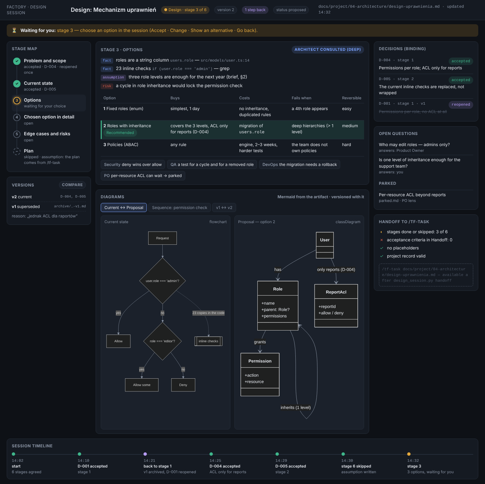

# Dashboard sesji projektowej `/tf-design`

Data: 2026-11-22. Pomysł właściciela: dashboard dla `/tf-design` na wzór dashboardu `/tf-task`, dopasowany do sesji
projektowej, z rysunkami (Mermaid i podobne). Decyzja właściciela: **na razie nie robimy** — wracamy po pierwszych
sesjach `/tf-design` w praktyce. Nic z tego planu nie jest zrobione.

## Makieta



Przykład: sesja „Mechanizm uprawnień”, etap 3 z 6, jeden powrót do etapu 1. Kolory i układ jak w
`core/skills/tf/templates/dashboard.html`. Diagramy narysowane prawdziwym Mermaidem (11.4.1).

| Miejsce | Co pokazuje |
|---|---|
| nagłówek | stan sesji (Explore / Design: etap n z m / gotowe do przekazania), wersja, liczba powrotów, status artefaktu |
| „Waiting for you” | na jaką decyzję sesja czeka (decyzja zapada w sesji, nie w przeglądarce) |
| mapa etapów | etapy ze statusem i decyzją D-NNN; pominięty etap z założeniem; „reopened” |
| wersje | bieżąca i poprzednie z `archive/` z powodem powrotu |
| bieżący etap | twierdzenia oznaczone fact / assumption / recommendation / risk; tabela wariantów z rekomendowanym; wnioski z soczewek ról |
| diagramy | bloki ```` ```mermaid ```` bieżącego etapu: stan obecny obok propozycji; zakładki: inne diagramy, v1 ↔ v2 |
| decyzje | obowiązujące D-NNN; cofnięte przekreślone (`reopened`) |
| otwarte pytania, odłożone | kto ma odpowiedzieć |
| przekazanie do `/tf-task` | warunki `design_session.py handoff` i wyszarzone polecenie `/tf-task …` |
| oś czasu | start, akceptacje, powroty, pominięcia |

## Rekomendacje (z rozmowy 2026-11-22)

1. **Osobna strona** `.tf/runs/design-<slug>.html`, w wyglądzie dashboardu pętli i połączona z nim linkami
   („Zadania” ↔ „Projekty”). Inna treść i inny cykl życia niż przebieg pętli; dashboard `/tf-task` zostaje nietknięty.
   Generuje ją `design_session.py` przy `start` / `stage` / `handoff`, `status --open` otwiera na żądanie.
2. **Mermaid nie w silniku na stałe.** ~2,5 MB (10× więcej niż jedyny dołączony pakiet, `_vendor/yaml` 260 KB),
   przegląd bezpieczeństwa i aktualizacje przy karencji 7 dni; dashboard nie może sięgać do CDN (zasada „bez sieci”).
   Domyślnie diagram jako czytelny tekst; renderowanie, gdy lokalnie jest `.tf/vendor/mermaid.min.js` (dashboard
   podaje jedno polecenie do jawnego pobrania, np. `npm pack mermaid@<wersja>` — wykonuje człowiek). Artefakt i tak
   renderuje się na GitHubie i w IDE.
3. **Tylko podgląd.** Akceptacja, zmiana, powrót zostają w sesji (AskUserQuestion) i w `design_session.py`. Klikanie
   w przeglądarce wymagałoby lokalnego serwera — nowa powierzchnia ataku i drugi kanał zapisu decyzji z pominięciem
   rozmowy.

## MVP (jeden PR, TDD), gdy wrócimy

- Generator w `design_session.py` i szablon `design.html`: nagłówek, baner, mapa etapów, bieżący etap (sekcja z
  artefaktu), diagramy z bloków Mermaid, decyzje z `decisions.md`, otwarte pytania, warunki przekazania (ta sama
  logika co `handoff`), lista wersji z linkami do `archive/`.
- Testy: strona zawiera etapy, decyzje i warunki przekazania; działa bez Mermaida (tekst) i z nim.
- Odłożone: porównanie v1 ↔ v2 obok siebie, oś czasu z dziennika, wspólny widok z `/tf-task`, odświeżanie strony.

## Decyzje do podjęcia przy powrocie

1. Osobna strona czy wspólny widok z dashboardem `/tf-task`.
2. Mermaid opcjonalny (rekomendacja) czy dołączony do silnika.
3. Tylko podgląd (rekomendacja) czy interakcja w przeglądarce.
