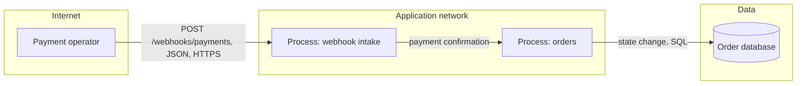

# Examples — the threat model

## 1. A payment webhook from a partner: a DFD and STRIDE
**Situation.** "We are adding an endpoint to which the payment operator sends payment confirmations. After confirmation the order
moves to the "paid" state and goes to shipping."

**How.**
1. **Trigger**: a new entry point (a webhook) from a partner → a full model, not a comment in the review.
2. **Scope and assets**: money (shipping without payment), the integrity of order states, the availability of accepting payments.
3. **A DFD** with trust boundaries; every boundary crossing is a threat candidate.
4. **STRIDE per element**: for a process all six letters, for a flow across a boundary T/I/D, for a store T/I/D.
5. **A decision** for every threat and an abuse case test; I leave acceptances to the human.

**Result** (a fragment of `04-architecture/threat-model.md`):

| ID | Element | STRIDE | Scenario | L | I | R | Decision and control | Abuse case test |
|---|---|---|---|---|---|---|---|---|
| T-1 | PSP → WH | S | An attacker can send a fake confirmation through the public endpoint, because we do not verify the sender; consequence: goods shipped without payment | 3 | 3 | 9 | mitigate: verify the signature (MAC) of every request | a request without a signature or with a wrong one → 401, state unchanged |
| T-2 | PSP → WH | T | An attacker can replay an intercepted, correctly signed request, because we do not reject duplicates; consequence: double booking | 2 | 2 | 4 | mitigate: an event id + deduplication, a timestamp with a tolerance window | the same request twice → one effect |
| T-3 | WH | D | An attacker can flood the endpoint with requests, because there is no limit; consequence: real payments are not accepted | 2 | 2 | 4 | mitigate: a request limit, a fast response and asynchronous handling | 1000 requests/s without a signature → rejected, p95 of real ones unchanged |
| T-4 | WH | I | An attacker can learn internal details from error messages, because we return the stack trace; consequence: an easier further attack | 2 | 1 | 2 | mitigate: fail closed, a generic message (A10) | malformed JSON → 400 without a stack trace |
| T-5 | WH | R | The operator claims it did not send the confirmation, and we have no trace | 1 | 2 | 2 | mitigate: an audit log of raw requests with the signature | a log entry for every request |

A 1–3 scale, R = L × I; the action threshold from the ADR: R ≥ 4 is mitigated before deployment. A `proposed` model → a human's acceptance.

## 2. Downloading invoices: the attack surface and an abuse case test
**Situation.** "The customer is to have a "Download PDF invoice" button in the panel. Endpoint: `GET /invoices/{id}/pdf`."

**How.**
1. A new entry point from the internet and customer data → an entry on the attack surface list.
2. Questions: who has access, what data it accepts, what control.
3. The most dangerous class: A01 Broken Access Control — the identifier in the path can be swapped.
4. The control goes to the backlog, the abuse case test to the test plan (qa-test-design).

**Result**:

| Entry point | Who has access | Input data | Control |
|---|---|---|---|
| `GET /invoices/{id}/pdf` | a logged-in user | the invoice `id` in the path | the session + a check whether the invoice belongs to the user's account |

Threat T-7 (process, E/I): "An attacker [logged-in customer B] can download customer A's invoice by swapping the `id`
in the address, because the endpoint only checks the login, consequence: disclosure of personal data and amounts (asset: customer data)".
L = 3, I = 3, R = 9 → mitigate. Task: object-level authorization. Abuse case test:
"user B downloads user A's invoice → 404 (not 403, so as not to confirm the invoice exists)".

## 3. Is protection worth it: a quantitative assessment
**Situation.** "The board asks whether to spend PLN 80 thousand a year on additional protection against customer account takeover in the shop."

**How.**
1. A budget decision made by the business → a quantitative assessment (FAIR) instead of a 1–3 scale.
2. I give the loss event frequency and loss magnitude as ranges (min, most likely, max) from incident
   data, not from one person's intuition.
3. A Monte Carlo simulation gives the annual loss in a range; I compute it before the control and after it (residual risk).
4. I compare the result with the cost of the control; a human makes the risk acceptance decision with an owner and a review date.

**Result** (illustrative numbers from the shop's incident data for 2 years):

| Quantity | Min | Most likely | Max |
|---|---|---|---|
| account takeover events per year (today) | 4 | 10 | 25 |
| loss per event (refunds, handling, fines) | PLN 5 thousand | PLN 18 thousand | PLN 60 thousand |
| events per year (after the control) | 0 | 2 | 6 |

The simulation (10,000 runs, triangular distributions from the table): the annual loss today — a median of about PLN 350 thousand,
the 90th percentile about PLN 550 thousand; after the control — a median of about PLN 70 thousand. The median drop of about PLN 280 thousand > the control cost
of PLN 80 thousand → the recommendation *mitigate*. The residual risk (a median of about PLN 70 thousand/year) goes to acceptance: owner —
the e-commerce director, review in 12 months.
