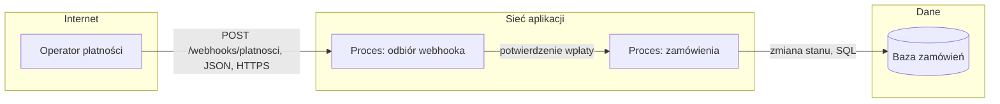

# Przykłady — model zagrożeń

## 1. Webhook płatności od partnera: DFD i STRIDE
**Sytuacja.** „Dodajemy endpoint, na który operator płatności wysyła potwierdzenia wpłat. Po potwierdzeniu zamówienie
przechodzi w stan »opłacone« i idzie do wysyłki.”

**Jak.**
1. **Wyzwalacz**: nowy punkt wejścia (webhook) od partnera → pełny model, nie uwaga w review.
2. **Zakres i aktywa**: pieniądze (wysyłka bez zapłaty), integralność stanu zamówień, dostępność przyjmowania wpłat.
3. **DFD** z granicami zaufania; każde przecięcie granicy to kandydat na zagrożenie.
4. **STRIDE per element**: dla procesu wszystkie sześć liter, dla przepływu przez granicę T/I/D, dla magazynu T/I/D.
5. **Decyzja** dla każdego zagrożenia i test nadużycia; akceptacje zostawiam człowiekowi.

**Wynik** (fragment `04-architecture/threat-model.md`):

| ID | Element | STRIDE | Scenariusz | P | W | R | Decyzja i kontrola | Test nadużycia |
|---|---|---|---|---|---|---|---|---|
| Z-1 | PSP → WH | S | Napastnik może wysłać fałszywe potwierdzenie przez publiczny endpoint, bo nie sprawdzamy nadawcy; skutek: towar wysłany bez zapłaty | 3 | 3 | 9 | ograniczyć: weryfikacja podpisu (MAC) każdego żądania | żądanie bez podpisu lub z błędnym → 401, stan bez zmian |
| Z-2 | PSP → WH | T | Napastnik może powtórzyć przechwycone, poprawnie podpisane żądanie, bo nie odrzucamy duplikatów; skutek: podwójne księgowanie | 2 | 2 | 4 | ograniczyć: id zdarzenia + deduplikacja, znacznik czasu z oknem tolerancji | to samo żądanie dwa razy → jeden efekt |
| Z-3 | WH | D | Napastnik może zalać endpoint żądaniami, bo nie ma limitu; skutek: prawdziwe wpłaty nie są przyjmowane | 2 | 2 | 4 | ograniczyć: limit żądań, szybka odpowiedź i obsługa asynchroniczna | 1000 żądań/s bez podpisu → odrzucone, p95 prawdziwych bez zmian |
| Z-4 | WH | I | Napastnik może poznać szczegóły wnętrza z komunikatów błędów, bo zwracamy stos wywołań; skutek: łatwiejszy dalszy atak | 2 | 1 | 2 | ograniczyć: fail closed, ogólny komunikat (A10) | błędny JSON → 400 bez stosu wywołań |
| Z-5 | WH | R | Operator twierdzi, że nie wysłał potwierdzenia, a my nie mamy śladu | 1 | 2 | 2 | ograniczyć: log audytowy surowych żądań z podpisem | wpis w logu dla każdego żądania |

Skala 1–3, R = P × W; próg akcji z ADR: R ≥ 4 ogranicza się przed wdrożeniem. Model `proposed` → akceptacja człowieka.

## 2. Pobieranie faktur: powierzchnia ataku i test nadużycia
**Sytuacja.** „Klient ma mieć w panelu przycisk »Pobierz fakturę PDF«. Endpoint: `GET /faktury/{id}/pdf`.”

**Jak.**
1. Nowy punkt wejścia z internetu i dane klientów → wpis na liście powierzchni ataku.
2. Pytania: kto ma dostęp, jakie dane przyjmuje, jaka kontrola.
3. Najgroźniejsza klasa: A01 Broken Access Control — identyfikator w ścieżce można podmienić.
4. Kontrola trafia do backlogu, test nadużycia do planu testów (qa-test-design).

**Wynik**:

| Punkt wejścia | Kto ma dostęp | Dane wejściowe | Kontrola |
|---|---|---|---|
| `GET /faktury/{id}/pdf` | zalogowany użytkownik | `id` faktury w ścieżce | sesja + sprawdzenie, czy faktura należy do konta użytkownika |

Zagrożenie Z-7 (proces, E/I): „Napastnik [zalogowany klient B] może pobrać fakturę klienta A przez podmianę `id`
w adresie, bo endpoint sprawdza tylko zalogowanie, skutek: ujawnienie danych osobowych i kwot (aktywo: dane klientów)”.
P = 3, W = 3, R = 9 → ograniczyć. Zadanie: autoryzacja na poziomie obiektu. Test nadużycia:
„użytkownik B pobiera fakturę użytkownika A → 404 (nie 403, żeby nie potwierdzać istnienia faktury)”.

## 3. Czy ochrona się opłaca: ocena ilościowa
**Sytuacja.** „Zarząd pyta, czy wydać 80 tys. zł rocznie na dodatkową ochronę przed przejęciem kont klientów w sklepie.”

**Jak.**
1. Decyzja budżetowa podejmowana przez biznes → ocena ilościowa (FAIR) zamiast skali 1–3.
2. Częstość zdarzeń strat i wielkość straty podaję jako przedziały (min, najbardziej prawdopodobne, max) z danych
   o incydentach, nie z intuicji jednej osoby.
3. Symulacja Monte Carlo daje roczną stratę w przedziale; liczę ją przed kontrolą i po niej (ryzyko rezydualne).
4. Wynik porównuję z kosztem kontroli; decyzję o akceptacji ryzyka podejmuje człowiek z właścicielem i datą przeglądu.

**Wynik** (liczby ilustracyjne z danych incydentów sklepu za 2 lata):

| Wielkość | Min | Najbardziej prawdopodobne | Max |
|---|---|---|---|
| zdarzenia przejęcia kont na rok (dziś) | 4 | 10 | 25 |
| strata na zdarzenie (zwroty, obsługa, kary) | 5 tys. zł | 18 tys. zł | 60 tys. zł |
| zdarzenia na rok (po kontroli) | 0 | 2 | 6 |

Symulacja (10 000 przebiegów, rozkłady trójkątne z tabeli): roczna strata dziś — mediana ok. 350 tys. zł,
90. percentyl ok. 550 tys. zł; po kontroli — mediana ok. 70 tys. zł. Spadek mediany ok. 280 tys. zł > koszt kontroli
80 tys. zł → rekomendacja *ograniczyć*. Ryzyko rezydualne (mediana ok. 70 tys. zł/rok) idzie do akceptacji: właściciel —
dyrektor e-commerce, przegląd za 12 miesięcy.
