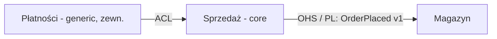

# Mapa kontekstów i integracja

Mapa kontekstów to jeden z najważniejszych artefaktów: pokazuje, kto od kogo zależy i jak modele się tłumaczą.
Rób kilka małych map pod konkretne pytania zamiast jednej gigantycznej.

## Relacje zespołów
- **Upstream / downstream** — zmiany u dostawcy (upstream) wpływają na odbiorcę (downstream), odwrotnie nie.
- **Wzajemna zależność** — oba zespoły muszą dowozić razem.
- **Niezależność** — zmiany jednego nie wpływają na drugi.

## Wzorce — kiedy który
| Wzorzec | Kiedy wybrać | Koszt / ryzyko |
|---|---|---|
| **Open Host Service (OHS)** | upstream ma wielu odbiorców; zamiast integracji szytych na miarę udostępnia jeden stabilny, udokumentowany protokół (API, zdarzenia) | trzeba utrzymywać kontrakt i wersjonowanie; kontrakt **nie może** być wewnętrznym modelem wystawionym na zewnątrz |
| **Published Language** | wspólny, dobrze opisany format wymiany (często razem z OHS; np. standardy branżowe, schematy zdarzeń) | zmiany języka wymagają uzgodnień |
| **Anti-Corruption Layer (ACL)** | downstream chroni swój model przed obcym (legacy, zewnętrzny dostawca, subdomena generic) | warstwa tłumaczeń do utrzymania; opłaca się dla core domain |
| **Conformist** | downstream przyjmuje model upstream wprost, bo nie ma wpływu, a model jest „wystarczająco dobry” | tracisz własny język; nie dla core domain |
| **Customer / Supplier** | upstream uwzględnia potrzeby downstream w planowaniu; wynegocjowane zobowiązania | wymaga dojrzałej współpracy i budżetu po stronie dostawcy |
| **Partnership** | dwa konteksty zależne od siebie, planowane razem | silne sprzężenie organizacyjne |
| **Shared Kernel** | mały, jawnie uzgodniony wspólny fragment modelu/kodu | każda zmiana wymaga konsultacji; trzymaj minimalny |
| **Separate Ways** | integracja kosztuje więcej, niż daje | możliwe dublowanie funkcji |
| **Big Ball of Mud** | oznacz obszar bez spójnego modelu, żeby jego bałagan nie „przeciekał” | izoluj ACL-em |

Heurystyka: konteksty core → chroń ACL-em albo bądź upstreamem z OHS; generic → konformizm lub ACL do gotowca.

**ACL wobec biblioteki lub SDK** (nie tylko innego kontekstu): obiekt wartości domeny jako jedyne miejsce wiedzy
o kształcie zależności + wąski port w języku domeny + adapter owijający bibliotekę. Kryterium ukończenia jest
sprawdzalne: `rg -l "from '<pakiet>'"` zwraca wyłącznie pliki katalogu adaptera. Egzekwujesz je regułą w CI
(dependency-cruiser `forbidden`, ESLint `no-restricted-imports`, ArchUnit), nie pamięcią — szablony:
`.claude/skills/ddd-legacy-modernization/references/szablony-regul.md`. Szczególnie groźny przeciek: biblioteka
serwerowa w paczce klienta.

## Serwisy krawędziowe i wewnętrzne
- **Serwis krawędziowy** (na granicy kontekstu/modułu): fasada lub serwis aplikacyjny, endpoint API, publikator zdarzeń
  integracyjnych. Tłumaczy język zewnętrzny na wewnętrzny, pilnuje autoryzacji, transakcji i idempotencji, orkiestruje
  scenariusz. Jest **cienki i stabilny** — inne konteksty rozmawiają **wyłącznie** z krawędzią (to jest ich OHS).
- **Serwis wewnętrzny**: serwisy domenowe, polityki, agregaty — logika w głębi modelu. Może się dowolnie zmieniać,
  bo nikt z zewnątrz od niego nie zależy.
- Dąż do **modułów głębokich**: mały, stabilny interfejs na krawędzi i dużo zachowania pod spodem. Przykład: kontekst
  dostępności wystawia tylko `zablokuj / zwolnij / wyłącz` zasób w czasie, a cała złożoność segmentów czasu i blokad
  jest w środku (ddd-archetypes).
- Sygnały błędu: inne moduły wołają serwisy wewnętrzne albo repozytoria; krawędź zwraca encje domenowe zamiast DTO/zdarzeń;
  logika biznesowa „wycieka” do kontrolera.

## Zdarzenia między kontekstami
Rozróżniaj **zdarzenie domenowe** (wewnętrzne, pełny język kontekstu, może się zmieniać) od **zdarzenia integracyjnego**
(publiczne, na krawędzi, w Published Language, wersjonowane).

| Styl | Co niesie | Zalety | Wady | Kiedy |
|---|---|---|---|---|
| **Event notification** | „coś się stało” + identyfikator | minimalne sprzężenie, prosty | odbiorca musi dopytać źródło; trudno śledzić przepływ z wielu zdarzeń | odbiorca potrzebuje tylko sygnału |
| **Event-carried state transfer** | zdarzenie + stan potrzebny odbiorcom | odbiorca działa, gdy źródło leży; brak zapytań zwrotnych; mniejsze opóźnienia | duplikacja danych, spójność ostateczna, ewolucja schematu | odbiorca potrzebuje lokalnej kopii danych do własnych decyzji |
| **Event sourcing** | zdarzenia są źródłem prawdy stanu | pełny audyt, odtwarzanie stanu | złożoność, ewolucja zdarzeń | audyt/historia to wartość biznesowa |

Zasady dla **event-carried state transfer**: wysyłaj tylko dane potrzebne odbiorcom (nie cały agregat), wersjonuj schemat,
odbiorca buduje własny read model i akceptuje spójność ostateczną, obsługa jest idempotentna i odporna na kolejność
(numer wersji/sekwencji), źródło pozostaje jedynym właścicielem danych.

## Gwarancje dostarczenia
- Zapis stanu i zdarzenia w jednej transakcji → **outbox**; dostarczanie co najmniej raz → **idempotentni odbiorcy**.
- Procesy przez wiele kontekstów → saga / proces menedżer z jawnymi krokami kompensacji.
- Zanim zamienisz wywołanie synchroniczne na wiadomość: czy wywołujący używa wyniku? czy ktoś czyta efekt od razu? komenda czy
  zdarzenie? Kolejność nie jest gwarantowana. Asynchroniczność usuwa sprzężenie czasowe, nie logiczne.
  Pełna procedura, atomowość i testy: be-messaging-outbox.

## Weryfikacja relacji pomiarem
Relację z mapy można sprawdzić pomiarem connascence (ddd-connascence-analysis) — przed kodem na kontraktach (stopnie jako przedziały),
po kodzie na kodzie (rozstrzyga kod). OHS/Published Language powinny dawać głównie sprzężenie statyczne słabe (nazwa, typ);
sprzężenia dynamiczne przez granicę (wspólna transakcja, dane, które muszą się zgadzać) = granica przecieka.

## Zapis wyniku (`docs/project/02-domain/context-map.md`)

Pod diagramem tabela: relacja, wzorzec, upstream/downstream, kontrakt (API/zdarzenia + wersja), właściciel, uzasadnienie.

## Źródła
- Kurs 10xDevs, ed. 3 (2026), moduł 4, lekcja 5 (ACL wobec biblioteki, kryterium „pakiet tylko w adapterze”) —
  materiał szkoleniowy (dostęp 2026-10-09); opisane własnymi słowami.
