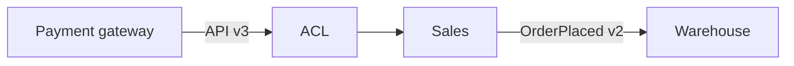

# Context mapping — relations and integration between contexts

Boundaries are already drawn (ddd-strategic-analysis). This skill decides **how** contexts talk: who adapts to whom, what
crosses the boundary, how it is delivered, and how the relation is verified.

**Result:** `docs/project/02-domain/context-map.md` — a Mermaid `flowchart LR` plus a table: relation, pattern,
upstream / downstream, contract with its version, owner, justification. Contexts, teams or integrations not given → ask
for them; do not invent a map.

## 1. Maps
Draw several small maps, one per question (payments, fulfilment, reporting), rather than one wall chart. For each relation
first name the team relationship:
- **upstream / downstream** — the upstream's changes land on the downstream;
- **mutual dependency** — both must release together;
- **independent** — no integration needed.

## 2. Choosing the pattern
| Pattern | Use when | What it costs |
|---|---|---|
| Open Host Service | an upstream with many consumers offers one stable, documented protocol | a contract to version; it must not mirror the internal model |
| Published Language | a documented exchange format shared by several parties (an industry standard, an event schema) — often with OHS | changes need agreement |
| Anti-Corruption Layer | the downstream protects its model from a legacy, vendor or generic model | a translation layer to build and maintain; worth it for the core |
| Conformist | the downstream has no influence and the upstream model is good enough | the downstream loses its own language — **never for the core** |
| Customer / Supplier | the upstream plans for the downstream's needs | requires a mature relationship and the supplier's budget |
| Partnership | a pair of contexts planned and released together | strong organisational coupling |
| Shared Kernel | a tiny, explicitly agreed shared model or code | every change is negotiated |
| Separate Ways | integration costs more than it brings | accepted duplication |
| Big Ball of Mud | a tangled area you cannot fix now | label it and fence it off with an ACL |

Heuristic: a core context sits behind an ACL or is the upstream with an OHS; a generic one conforms to the off-the-shelf
product or uses a thin ACL. Enforce an ACL in CI (section 6) — an unverified layer erodes within months.

## 3. Edge and internal services
- **Edge service** — at the context's boundary: an application service, facade, API endpoint or integration-event
  publisher. It translates languages, enforces authorisation, owns the transaction and idempotency and orchestrates the
  scenario. Thin and stable; other contexts talk **only** to it — it is their open host.
- **Internal** — domain services, policies, aggregates (ddd-tactical-design); free to change.
- Prefer a deep module: a small, stable edge with a lot of behaviour behind it. Example: a scheduling context exposes
  only `reserve(slot)`, `release(slot)` and `blockResource(period)`; calendars, conflict rules and locks stay inside.
- Smells: other contexts call internal services or repositories; the edge returns entities instead of DTOs or events;
  business rules in a controller.

## 4. Events between contexts
- A **domain event** is internal, rich and may change with the model. An **integration event** is public, published at
  the edge in the published language, and versioned.
- Styles:
  - **notification** — a signal and an id; low coupling, but the consumer must call back and the flow is harder to trace;
  - **event-carried state transfer** — the event carries the state the consumers need; they keep working when the source
    is down, at the price of duplicated data, eventual consistency and schema evolution;
  - **event sourcing** — events are the record of truth; full history and audit, high complexity; choose it only when the
    history itself is business value.
- Rules for event-carried state transfer:
  - send the data consumers need, not the whole aggregate;
  - version the schema; add attributes compatibly, remove them through a new version;
  - each consumer builds its own read model;
  - handle events idempotently and tolerate reordering — compare a version or sequence number and ignore stale events;
  - the source stays the **only owner** of the data; consumers hold copies, never edit them.

## 5. Delivery
- State and event written in one transaction → an outbox; at-least-once delivery → idempotent consumers; a process across
  several contexts → a saga or process manager with explicit compensation. Details: be-messaging-outbox.
- Before replacing a synchronous call with an asynchronous event ask: does the caller need the result? does someone read the effect
  immediately? is it a command or an event? Events may arrive out of order. Asynchrony removes temporal coupling, not
  logical coupling.

## 6. An anti-corruption layer around a library or SDK
An ACL is worth it for a third-party package too, when the package's model would otherwise spread through your code
(a payment SDK, a date or money library, a PDF generator).
- **Structure:** a narrow port in the domain's language; one adapter that wraps the library; a domain value object as the
  only place that knows the shape the dependency needs.
- **Done means verifiable:** searching for imports of the package (`rg -l "from 'pdf-lib'" src/`) lists only files in the
  adapter directory.
- **Keep it done:** a rule in CI, not a promise — dependency-cruiser `forbidden` rules, ESLint `no-restricted-imports`
  with an exception for the adapter path, ArchUnit for the JVM. Templates:
  `.claude/skills/ddd-legacy-modernization/references/rule-templates.md`.
- A dangerous leak to look for: a server-only library pulled into the client bundle through a shared module.

## 7. Verifying a relation
Measure it with connascence (ddd-connascence-analysis): before the code exists, on the contracts (as a range); afterwards,
on the code (the code wins). An OHS or published language should leave mostly weak static coupling (name, type).
Dynamic coupling across a boundary — a shared transaction, values that must agree at the same moment — means the boundary
leaks.

## 8. Identity across contexts
Concepts and things both need identity, and they are handled differently:
- **Concepts** — classes, properties, metrics (e.g. "revenue", "active customer"). One definition with one owner in the
  glossary, and a stable identifier in the glossary owner's namespace. Teams that compute "revenue" differently are using
  different concepts and must name them apart.
- **Things** — a supplier, an order, a product. The identifier is minted by a rule from a business key (e.g. VAT number +
  country), so the same supplier gets the same id in CRM, ERP and procurement; existing local ids map to it in a key-mapping
  table.
- The data stays with its owners; only identity is shared — no central database of everything.
- The minting rule lives in a specification plus a small shared library that every system uses, not inside one tool.
- Pipelines and lineage between data products: data-engineering.

## Example
**Situation:** "Sales (core) integrates an external payment gateway whose model is awkward."
**Result:**
- Relation: the gateway is upstream, Sales downstream; no influence over the gateway.
- Pattern: ACL, not conformist — conforming would put "charge intents" and "captures" into Sales' language, and Sales is core.
- Structure: port `PaymentAuthorizer.authorize(order, amount)` → adapter translating to the gateway SDK; `PaymentReference`
  value object holds the gateway's id format.
- Enforcement: `no-restricted-imports` for the SDK outside `src/payments/adapter/`; `rg -l` lists only that directory.
- `context-map.md` row: Sales ← Payment gateway | ACL | upstream: gateway | API v3 | owner: Sales team | core must keep its language.

