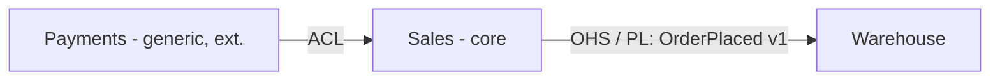

# Context map and integration

The context map is one of the most important artifacts: it shows who depends on whom and how the models translate.
Make several small maps for specific questions instead of one gigantic one.

## Team relations
- **Upstream / downstream** — changes at the supplier (upstream) affect the consumer (downstream), not the other way round.
- **Mutual dependency** — both teams have to deliver together.
- **Independence** — the changes of one do not affect the other.

## Patterns — when to use which
| Pattern | When to choose it | Cost / risk |
|---|---|---|
| **Open Host Service (OHS)** | the upstream has many consumers; instead of tailor-made integrations it exposes one stable, documented protocol (an API, events) | the contract and versioning have to be maintained; the contract **must not** be the internal model exposed to the outside |
| **Published Language** | a shared, well-described exchange format (often together with OHS; e.g. industry standards, event schemas) | changes to the language require agreement |
| **Anti-Corruption Layer (ACL)** | the downstream protects its model from a foreign one (legacy, an external supplier, a generic subdomain) | a translation layer to maintain; it pays off for the core domain |
| **Conformist** | the downstream adopts the upstream model directly, because it has no influence and the model is "good enough" | you lose your own language; not for the core domain |
| **Customer / Supplier** | the upstream takes the downstream's needs into account in planning; negotiated commitments | requires mature cooperation and budget on the supplier's side |
| **Partnership** | two contexts dependent on each other, planned together | strong organizational coupling |
| **Shared Kernel** | a small, explicitly agreed shared fragment of the model/code | every change requires consultation; keep it minimal |
| **Separate Ways** | integration costs more than it gives | possible duplication of features |
| **Big Ball of Mud** | mark an area without a coherent model, so that its mess does not "leak" | isolate it with an ACL |

A heuristic: core contexts → protect with an ACL or be the upstream with an OHS; generic → conformism or an ACL to a ready-made solution.

**An ACL towards a library or an SDK** (not only another context): a domain value object as the only place of knowledge
about the shape of the dependency + a narrow port in the domain language + an adapter wrapping the library. The completion criterion is
checkable: `rg -l "from '<package>'"` returns only files of the adapter directory. You enforce it with a rule in CI
(dependency-cruiser `forbidden`, ESLint `no-restricted-imports`, ArchUnit), not with memory — templates:
`.claude/skills/ddd-legacy-modernization/references/rule-templates.md`. A particularly dangerous leak: a server
library in the client bundle.

## Edge and internal services
- **An edge service** (at the boundary of a context/module): a facade or an application service, an API endpoint, a publisher of integration
  events. It translates the external language into the internal one, takes care of authorization, transactions and idempotency, orchestrates
  the scenario. It is **thin and stable** — other contexts talk **only** to the edge (this is their OHS).
- **An internal service**: domain services, policies, aggregates — the logic deep in the model. It can change freely,
  because nobody from the outside depends on it.
- Aim for **deep modules**: a small, stable interface at the edge and a lot of behaviour underneath. An example: the availability
  context exposes only `block / release / disable` a resource in time, and the whole complexity of time segments and locks
  is inside (ddd-archetypes).
- Error signals: other modules call internal services or repositories; the edge returns domain entities instead of DTOs/events;
  business logic "leaks" into the controller.

## Events between contexts
Distinguish a **domain event** (internal, the full language of the context, can change) from an **integration event**
(public, at the edge, in the Published Language, versioned).

| Style | What it carries | Advantages | Disadvantages | When |
|---|---|---|---|---|
| **Event notification** | "something happened" + an identifier | minimal coupling, simple | the consumer has to query the source; hard to trace a flow from many events | the consumer needs only a signal |
| **Event-carried state transfer** | the event + the state the consumers need | the consumer works when the source is down; no callback queries; lower latency | data duplication, eventual consistency, schema evolution | the consumer needs a local copy of the data for its own decisions |
| **Event sourcing** | events are the source of truth of the state | a full audit, state reconstruction | complexity, event evolution | audit/history is a business value |

Rules for **event-carried state transfer**: send only the data the consumers need (not the whole aggregate), version the schema,
the consumer builds its own read model and accepts eventual consistency, handling is idempotent and resilient to ordering
(a version/sequence number), the source remains the only owner of the data.

## Delivery guarantees
- Writing the state and the event in one transaction → an **outbox**; at-least-once delivery → **idempotent consumers**.
- Processes across many contexts → a saga / a process manager with explicit compensation steps.
- Before you replace a synchronous call with a message: does the caller use the result? does someone read the effect right away? a command or
  an event? Ordering is not guaranteed. Asynchrony removes temporal coupling, not logical coupling.
  The full procedure, atomicity and tests: be-messaging-outbox.

## Verifying a relation by measurement
A relation from the map can be checked by measuring connascence (ddd-connascence-analysis) — before the code on the contracts (degrees as ranges),
after the code on the code (the code decides). OHS/Published Language should give mainly weak static coupling (name, type);
dynamic coupling across the boundary (a shared transaction, data that must agree) = the boundary leaks.

## Identity between contexts: a concept versus a thing
- **Concepts** (classes, properties, metrics like "revenue") have a stable identifier in the namespace of the glossary's authors
  and one definition with an owner.
- **Things** (a supplier, an order) get an identifier minted by a rule from the business key: one thing = one
  identifier despite many records in systems (a key mapping table).
- The data stays with the context owners; only the identity is shared, not a copy of the data.
- The identifier minting rule lives in the specification and a shared library, not in one tool (data-engineering).
Source: S. Banerjee, "The Spine of the Context Fabric…" (2026-10-13).

## Recording the result (`docs/project/02-domain/context-map.md`)

Under the diagram a table: the relation, the pattern, upstream/downstream, the contract (API/events + version), the owner, the justification.

## Sources
- The 10xDevs course, ed. 3 (2026), module 4, lesson 5 (an ACL towards a library, the criterion "the package only in the adapter") —
  training material (accessed 2026-10-09); described in our own words.
