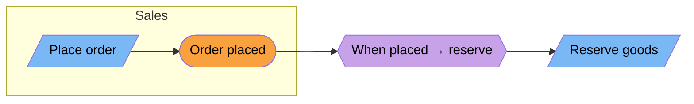

# Event Storming board write-up template

```markdown
# Event Storming: <topic> — <Big Picture | Process Level | Design Level>
Date: YYYY-MM-DD · Participants/sources: … · Session question: …
Mode: as-is | to-be | discovery   ·   Begin: "…"  ·  End: "…"

## Timeline
### Chapter 1: <name> (up to the pivotal event "…")
| # | Lane (swimlane) | Actor/System | Command | Event | Policy | Read model | Notes |
|---|---|---|---|---|---|---|---|
| 1 | Sales | Customer | Place order | Order placed | When placed → reserve goods | Cart, price list | |

★ Pivotal event: "…" — why pivotal: …

## Key (branching) questions
| Question | Where it comes up (# of events) | Who knows the answer / owner | Candidate for |
|---|---|---|---|

## Hot spots
- [ ] HS1: … (whom to ask, by when)

## Opportunities (to-be)
- …

## Glossary — new/changed terms
| Term | Meaning in this area | Synonyms / conflicts |
|---|---|---|

## Context candidates
- <Name>: events #…–#…; language: …; owner: …
```

## Diagram (optional)

