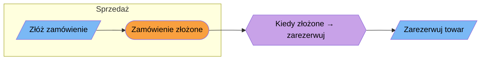

# Szablon zapisu tablicy Event Storming

```markdown
# Event Storming: <temat> — <Big Picture | Process Level | Design Level>
Data: RRRR-MM-DD · Uczestnicy/źródła: … · Pytanie sesji: …
Tryb: as-is | to-be | odkrywanie   ·   Begin: „…”  ·  End: „…”

## Oś czasu
### Rozdział 1: <nazwa> (do zdarzenia przełomowego „…”)
| # | Tor (swimlane) | Aktor/System | Komenda | Zdarzenie | Polityka | Read model | Uwagi |
|---|---|---|---|---|---|---|---|
| 1 | Sprzedaż | Klient | Złóż zamówienie | Zamówienie złożone | Kiedy złożone → zarezerwuj towar | Koszyk, cennik | |

★ Zdarzenie przełomowe: „…” — dlaczego przełomowe: …

## Pytania kluczowe (rozgałęziające)
| Pytanie | Gdzie pada (# zdarzeń) | Kto zna odpowiedź / właściciel | Kandydat na |
|---|---|---|---|

## Hot spoty
- [ ] HS1: … (kogo zapytać, do kiedy)

## Szanse (to-be)
- …

## Słownik — nowe/zmienione pojęcia
| Pojęcie | Znaczenie w tym obszarze | Synonimy / konflikty |
|---|---|---|

## Kandydaci na konteksty
- <Nazwa>: zdarzenia #…–#…; język: …; właściciel: …
```

## Diagram (opcjonalnie)

