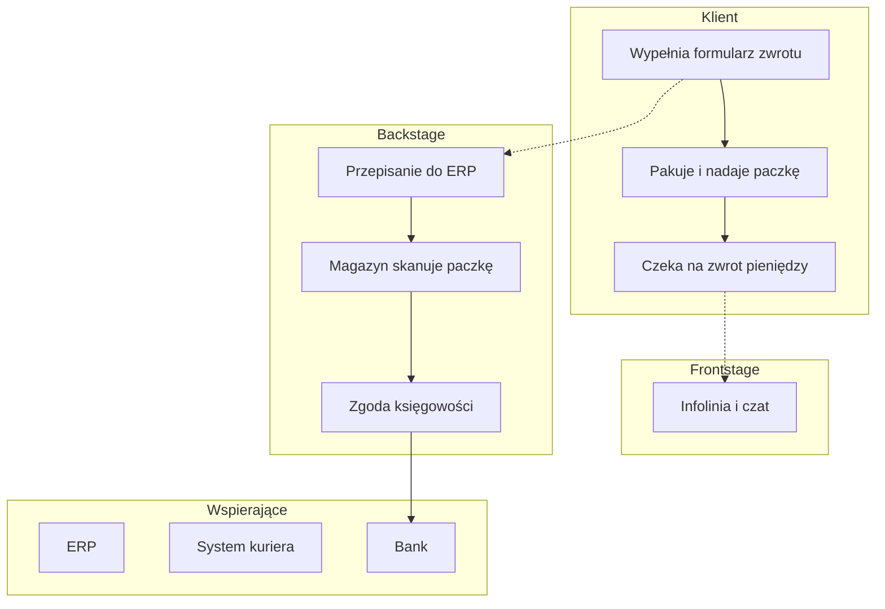

# Szablony artefaktów usługi

## Blueprint — tabela
Jak w przykładzie SKILL.md: kolumny to kroki w czasie, wiersze to pasy. Każdy punkt awarii ma ID (P1…), dowód
(liczba, cytat) i właściciela. Stan obecny i docelowy w osobnych sekcjach.

## Blueprint — Mermaid

Linie interakcji, widoczności i wewnętrznej opisz w przypisach lub jako osobne węzły-separatory; Mermaid nie ma
natywnych pasów, więc zachowaj kolejność subgraphów.

## Mapa podróży
| Etap | Działania klienta | Kanał | Myśli | Emocja (−2…+2) | Bolączka i dowód |
|---|---|---|---|---|---|
Mapa docelowa ma te same etapy, żeby dało się porównać.

## Mapa interesariuszy
| Strona | Rola w usłudze | Potrzeba | Wpływ (W/Ś/N) | Kto go słucha |
|---|---|---|---|---|

## Inwentarz punktów styku
| Punkt styku | Kanał | Właściciel | System | Dane wspólne z | Spójność (ta sama obietnica, język, dane) | Luka |
|---|---|---|---|---|---|---|

## Omnichannel — test spójności
Dla jednego przypadku klienta przejdź przez wszystkie kanały: czy zmiana kanału wymaga powtórzenia danych, czy
odpowiedź o stanie sprawy jest ta sama, czy pracownik widzi historię z innych kanałów.
