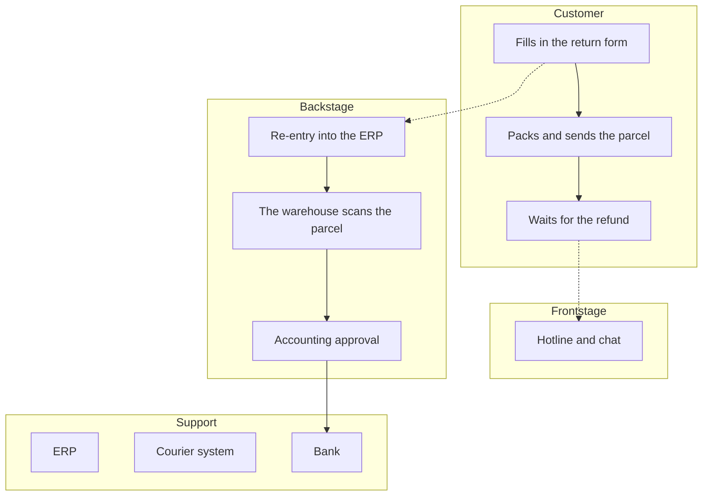

# Service artifact templates

## Blueprint — table
As in the SKILL.md example: the columns are steps in time, the rows are lanes. Every failure point has an ID (P1…), evidence
(a number, a quote) and an owner. The current and the target state in separate sections.

## Blueprint — Mermaid

Describe the lines of interaction, visibility and internal interaction in footnotes or as separate separator nodes; Mermaid has no
native lanes, so keep the order of the subgraphs.

## Journey map
| Stage | Customer actions | Channel | Thoughts | Emotion (−2…+2) | Pain point and evidence |
|---|---|---|---|---|---|
The target map has the same stages, so that they can be compared.

## Stakeholder map
| Party | Role in the service | Need | Influence (H/M/L) | Who listens to them |
|---|---|---|---|---|

## Touchpoint inventory
| Touchpoint | Channel | Owner | System | Data shared with | Consistency (the same promise, language, data) | Gap |
|---|---|---|---|---|---|---|

## Omnichannel — consistency test
For one customer case go through all channels: does a channel change require repeating data, is the
answer about the state of the matter the same, does the employee see the history from other channels.
